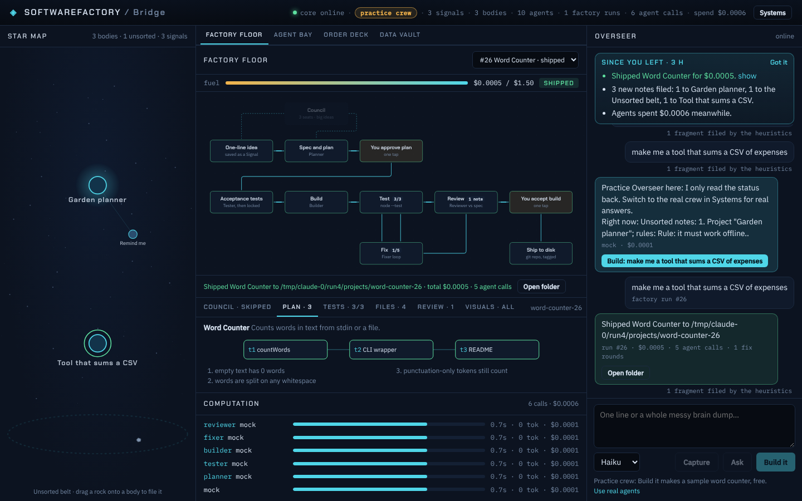
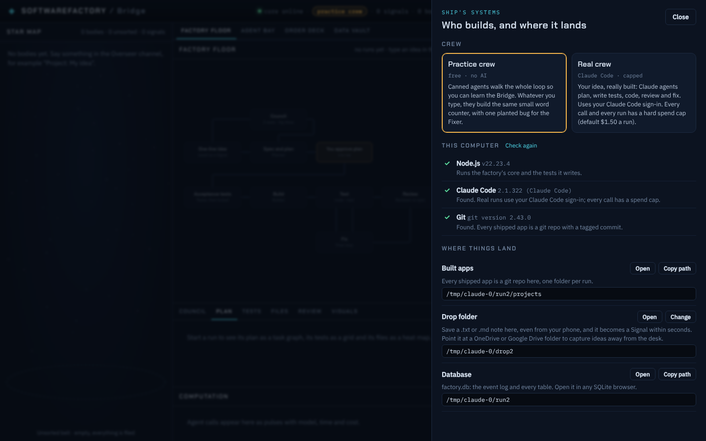

# SoftwareFactory

A loop-engineered software factory with an AI crew. Drop a messy idea in; an Order Engine keeps every thought in its place, and agents working in loops (council, plan, build, test, review, fix) turn it into working software, with as few human approval stops as possible. Everything is visualized.

Plan: [SoftwareFactory: MVP plan and tech stack](https://claude.ai/artifact/9vnEmBfz1VaSGaB1KKwh9H)



## Status: milestone 5 (Bridge polish and the Overseer)

The Bridge is now meant to be used every day, starting from a fresh Windows PC:

- **Nothing to install to start**: the Windows installer ships its own Node.js. Without Claude Code the app runs the free **practice crew** (canned agents that walk the whole loop and always build a sample word counter); with Claude Code installed and signed in it runs the **real crew**. Git is needed to ship apps.


- **Ship's systems** (the *Systems* button or the crew chip in the top bar): switch Practice / Real at any time (remembered in the database), see what this computer has (Node.js, Claude Code, Git, each with the one thing to do if it is missing) and **where things land**: the built-apps folder, the drop folder and the database, each with *Open* and *Copy path*.
- **Welcome and guidance**: a first launch shows what Build it, Capture and Ask do, with examples to try. A gate waiting for you is also said in the Overseer channel with a *Show me* button. A shipped run has an *Open folder* button. Agent failures read as what to do ("Claude Code is installed but not signed in: run `claude` and sign in"); the raw text stays in the log.
- **The Overseer** answers from a live status digest of the factory (runs, gates, conflicts, projects and their rules, spend), and when you describe something to build it offers a one-tap **Build** button. Nothing starts until you press it.
- **Since you left**: when you come back after 10 minutes or more, one card lists what shipped or failed, what waits for you, new conflicts, what was filed where, drops and spend.
- **Drop folder** (default `%USERPROFILE%\SoftwareFactory\Drop`, changeable in Systems): save a `.txt` or `.md` note there, even from your phone through OneDrive or Google Drive, and it becomes a Signal within seconds. The note moves to `filed/`; the same note is never read twice.
- **Live factory floor**: the agent working a station docks on it with its avatar, a scan line sweeps the active station, and the flowing edge glows. **Star map**: every factory idea becomes its own system at once (no Archivist call), ringed while building, amber when it waits for you, green when shipped; double-click it to watch its run.
- **When the core will not start**, the desktop app says why (Node missing, the core crashed), shows the core's log and has a *Restart the core* button. The core writes `core.log` in the data folder.
- **Storage**: crew mode and drop folder are `settings` rows, picked-up notes are `drops` rows, and "seen up to here" is a `bridge.seen` event, all derived from the log like every other table.

## Milestone 4 (the Agent Bay and the Council)

Agents are workers you create, edit, test and put on stations. Every factory run now goes:

```
idea → Council (3 seats, skipped for small jobs) → plan → [you approve plan] → tests (locked)
     → build → test ⇄ fix → Review (⇄ fix once) → [you accept build] → ship
```

- **Agent Bay** (`packages/core/src/bay`, Bridge tab *Agent Bay*): the built-in crew (Overseer, Archivist, Visionary, Architect, Skeptic, Planner, Tester, Builder, Reviewer, Fixer) are ordinary agents. Each has a name, avatar, model, cap per call, plugins (each agent loads only these; none = lean), skills, tools, a sample task and a prompt.
  - **Create** one by describing it in a line (the Overseer drafts it; free heuristics on the mock), clone one, or **import** an agent file. Agent files are Markdown with a header that mirrors Claude Code subagent files, so plonter-kit agents import as they are; any agent downloads as `.agent.md`.
  - **Every save is a version**; the Versions tab shows the prompt diff and rolls back (the restore is a new version, nothing is lost).
  - **Test** an agent on a sample task: one capped call, checked by the verifier of the station it was made for.
  - **Assign** by dragging a crew card onto a station seat (or the seat's picker). The Council takes three seats. The factory asks the Bay at the moment a station needs a worker, so an edit applies to the next call, and each call records the agent version that did it.
  - **Stats** per agent and per version: calls, cost, verifier pass rate, rounds per run, live state (idle, thinking, blocked) on the crew card.
  - **Station contracts**: an agent's prompt says who it is; the core appends the output contract of the station it works. Any agent can work any station, and editing an agent can never break the format the core parses.
- **Council** (`packages/core/src/factory/council.ts`): three seats answer the idea in parallel (take, proposals, concerns, vote build / reshape / drop). No build majority: each seat reads the others and answers again (round 2). Plain code merges the takes into a brief for the Planner (what two seats agree on, proposals, concerns). A majority "drop" asks you once; otherwise it never stops the run. Short single-ask ideas skip it (`council: auto|always|never`).
- **Review**: after the locked tests pass, the Reviewer checks the code against the spec. High-severity findings go to the Fixer once; the rest ride to the build gate as notes.
- **Bridge**: the Council box on the factory floor shows the votes, the run deck's Council tab draws the round table (seats coloured by vote, agreeing seats linked) with the brief and each take, and a Review tab shows the findings.
- **Storage**: agents, versions, slots, tests, verdicts, Council sessions and reviews are tables in the database (`bay_*`, `agent_verdicts`, `council_*`, `reviews`), derived from the event log like the rest.
- **First real run**: [docs/milestone-4-run.md](docs/milestone-4-run.md). The Council cost $0.0025 and turned "sum a CSV" into money in cents with every row accounted for; the CLI shipped for $0.29.

## Milestone 3 (the Order Engine)

Say anything, in any order, in the Overseer channel. Every Signal is filed:

```
Signal (raw, never edited) → Archivist: split · classify · route → Fragments under Project ▸ Idea ▸ Thread
   → emphasize (rules and decisions enter the node's Canon) · filter (noise hidden)
   → conflict check against the Canon (plain-code precedence) → visualizeEverything
daily sweep: fade stale notes · raise old questions · digest busy nodes · propose merges → one briefing
```

- **Archivist** (`packages/core/src/order`): Haiku in the lean profile, about $0.001 per Signal, with a per-call cap and a daily cap. It only proposes; the core checks the proposal and files it. A free heuristic Archivist takes over when the agent's answer is unusable, the cap is spent, or the runtime is the mock.
- **Canon is code, not a summary**: the rules and decisions on a node and its parents, each linked to the Signal it came from. Conflicts are resolved by the plan's order: your words beat inferred ones, the more specific node wins there only, newer beats older, important beats unmarked. It asks with a one-tap card when it is still tied, when an unmarked line would override a marked rule, or when a marked rule on a project itself would change.
- **Unsure placements never block**: under 50% confidence a fragment drifts in the Unsorted belt until you drag it onto a body.
- **Sweep and briefing**: every sweep action is an undoable event; pinned items, rules and decisions are never faded. Non-urgent items arrive as one Overseer briefing.
- **Bridge**: the star map is the real node tree (projects are systems, ideas planets, threads moons; size by activity, glow by important Canon, dim when stale), new fragments fly in as particles, conflicts are red links. The Order deck shows the Canon constellation of the selected body, the Unsorted tray, conflict cards, the briefing with undo, and every visual check.
- **Headless**: `npm run order -- messages.json --mode agent --project Name` files a whole conversation and prints the tree, Canon, conflicts and cost. First real result: [docs/milestone-3-run.md](docs/milestone-3-run.md) (this project's own chat: 33 fragments, the planted conflict caught, $0.014).

## Storage: database, files, cache

The core runs on an organized SQLite database, not loose files. Details: [docs/storage.md](docs/storage.md).

- **Database** (`factory.db`): the append-only event log is the source of truth; organized tables (`signals`, `agent_runs`, `factory_runs`, `artifacts`, `order_nodes`, `order_fragments`, `order_conflicts`) are kept current in the same transaction and can be rebuilt from the log at any time. Versioned migrations; an existing database is backed up before it is upgraded.
- **Files**: only real files (the generated repos), each pointed at by an `artifacts` row with its SHA-256.
- **Cache**: folded views in memory, keyed by the newest event, always safe to drop.
- **Bridge**: the Data vault tab draws all three, flags lagging tables and missing files, and has a one-click rebuild from the log.

## Milestone 2 (thin factory loop)

Type a one-line idea in the Overseer channel and press **Build it**. The factory runs:

```
idea → Planner (spec + task graph) → [you approve plan] → Tester (acceptance tests, then locked)
     → Builder → node --test ⇄ Fixer (max 5 rounds) → [you accept build] → git repo on disk, tagged v0.1.0
```

- **Loop engine** (`packages/core/src/factory`): every station is a loop with a worker, a verifier, exit criteria and a budget, all written to the event log.
- **Guards**: the Tester writes the tests from the spec before any code exists, and the core refuses any later write to `test/` and re-checks a hash of the tests before every run. One hard money cap per run. The same failures twice in a row, a station error or a spent budget stops at an escalation card instead of burning rounds.
- **Cheap agents**: agents run with no tools (lean profile) and answer in a strict file format; the core writes the files and runs the tests itself, inside the project folder only, with a scrubbed environment.
- **visualizeEverything in code**: before a station may pass, the core checks that every thing it produced has the event its Bridge view draws from (floor box, timeline pulse, task graph, test grid, file heat map). A missing visual fails the station.
- **Bridge**: the factory floor lights up per station with the fix-round counter and a fuel bar for the run budget; gates show an Approve / Send back bar; the run deck shows the plan as a task graph, tests as a pass and fail grid per round, files as a heat map (locked tests in amber), and every visual check.
- **Headless**: `npm run factory -- "<idea>"` runs the loop with both gates approved for you and prints the total cost. First real result: [docs/milestone-2-run.md](docs/milestone-2-run.md).

## Milestone 1 (skeleton and runtime spike)

- **Bridge UI** (`apps/bridge`): React + TypeScript. Star map (every Signal is a star in the Unsorted belt), factory floor (the 9 stations, React Flow), computation timeline (every agent call with model, time, tokens and cost), Overseer channel.
- **Core** (`packages/core`): TypeScript. Append-only SQLite event log with full-text search, Signals, the `AgentRuntime` adapter with per-call budget caps, a small JSON API and a live event stream.
- **Shell** (`src-tauri`): Tauri 2. Opens the Bridge and runs the core as a child process.
- **Skill** (`skills/visualize-everything`): the visualizeEverything station step.
- **Spike**: [docs/spike-runtime.md](docs/spike-runtime.md). Headless Claude Code in a lean profile costs about $0.0014 per short call on Haiku, versus about $0.99 with every plugin loaded on the default model.

## Run it

**Just use it (Windows)**: download [SoftwareFactory-setup.exe](https://github.com/PlonterAsi/SoftwareFactory/releases/download/latest/SoftwareFactory-setup.exe), run it (SmartScreen: *More info*, *Run anyway*), and start SoftwareFactory. For real agents install [Claude Code](https://claude.com/claude-code) and sign in once (`claude` in a terminal); for shipping apps install [Git](https://git-scm.com/download/win). The *Systems* panel checks both.

**From source**: needs Node 22.5+ (and the Claude Code CLI signed in for real agents). For the desktop app, also Rust and the [Tauri prerequisites](https://tauri.app/start/prerequisites/).

```bash
npm install
npm test                 # core tests

# In the browser (two processes: core on :4317, UI on :5173)
SF_RUNTIME=claude-code npm run dev -w @sf/core
npm run dev -w @sf/bridge
# open http://127.0.0.1:5173

# As a desktop app
npm run app

# File a conversation through the Order Engine (agent Archivist, capped)
npm run order -- examples/order/messy-chat.json --mode agent --max-usd 0.2 --db .sf-data/demo.db
SF_DB=.sf-data/demo.db npm run dev -w @sf/core   # then open the Bridge to see it

# Run the factory loop headless (real, capped model calls; gates auto-approved)
SF_RUNTIME=claude-code npm run factory -- "a CLI that renames photos by the date they were taken" --max-usd 1.5   # add --council always to seat the Council

# Re-run the runtime cost spike (makes a few real, capped model calls)
npm run spike
```

`SF_ORDER_MODE=heuristic|agent` picks the Archivist (default: agent on a real runtime, heuristics on the mock) and `SF_ORDER_MAX_USD` its daily cap (default $0.50). `SF_RUNTIME=mock` (the default for the Bridge) runs without any model calls: its crew builds a tiny word counter with a planted bug, so you can watch the whole loop, fix round included, for free. `SF_RUNTIME=claude-code:full` loads every installed plugin.
