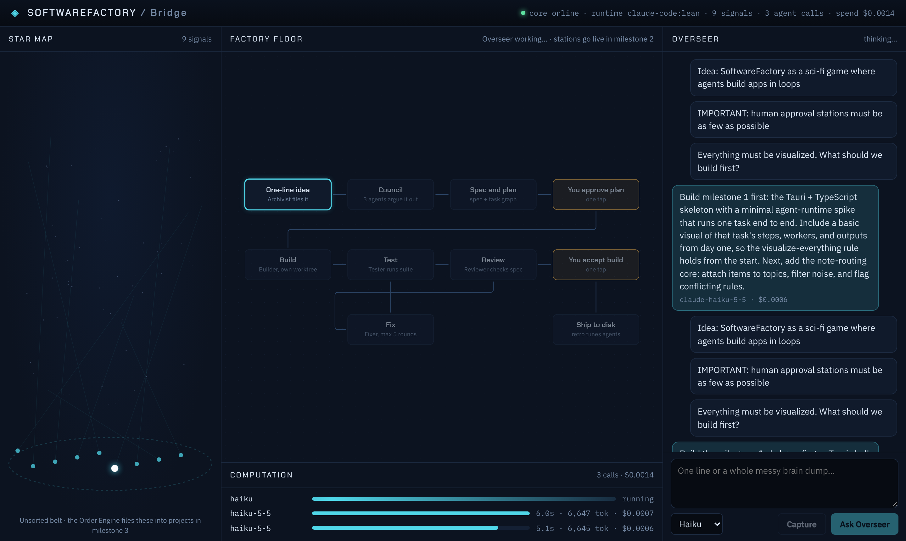

# SoftwareFactory

A loop-engineered software factory with an AI crew. Drop a messy idea in; an Order Engine keeps every thought in its place, and agents working in loops (council, plan, build, test, review, fix) turn it into working software, with as few human approval stops as possible. Everything is visualized.

Plan: [SoftwareFactory: MVP plan and tech stack](https://claude.ai/artifact/9vnEmBfz1VaSGaB1KKwh9H)



## Status: milestone 1 (skeleton and runtime spike)

- **Bridge UI** (`apps/bridge`): React + TypeScript. Star map (every Signal is a star in the Unsorted belt), factory floor (the 9 stations, React Flow), computation timeline (every agent call with model, time, tokens and cost), Overseer channel.
- **Core** (`packages/core`): TypeScript. Append-only SQLite event log with full-text search, Signals, the `AgentRuntime` adapter with per-call budget caps, a small JSON API and a live event stream.
- **Shell** (`src-tauri`): Tauri 2. Opens the Bridge and runs the core as a child process.
- **Skill** (`skills/visualize-everything`): the visualizeEverything station step.
- **Spike**: [docs/spike-runtime.md](docs/spike-runtime.md). Headless Claude Code in a lean profile costs about $0.0014 per short call on Haiku, versus about $0.99 with every plugin loaded on the default model.

## Run it

Needs Node 22+ and the Claude Code CLI signed in. For the desktop app, also Rust and the [Tauri prerequisites](https://tauri.app/start/prerequisites/).

```bash
npm install
npm test                 # core tests

# In the browser (two processes: core on :4317, UI on :5173)
SF_RUNTIME=claude-code npm run dev -w @sf/core
npm run dev -w @sf/bridge
# open http://127.0.0.1:5173

# As a desktop app
npm run app

# Re-run the runtime cost spike (makes a few real, capped model calls)
npm run spike
```

`SF_RUNTIME=mock` (the default) runs without any model calls. `SF_RUNTIME=claude-code:full` loads every installed plugin.
