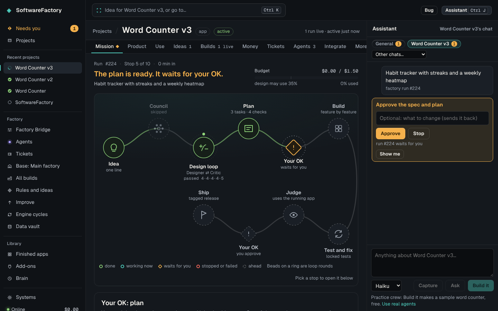

# SoftwareFactory

A loop-engineered software factory with an AI crew. Type one line; agents working in loops design the product, plan it, build it feature by feature, test, fix, review and judge it, and you approve twice. An Order Engine keeps every idea, rule and decision in its place. Everything is visualized, and what it builds are real programs with screens, not scripts.



## What it does today

```
one line → Council → Design loop (Designer ⇄ Critic) → Plan → [you approve]
         → locked tests → Build, one feature per session → test ⇄ fix → Review → Product Judge
         → [you accept] → ship (a tagged git repo you can start with one press)
```

- **The engine**: nested loops, each with its own goal, an outside observer and a budget. Tests are written first and locked; every screen is opened in a real browser; a separate judge scores the running app; every run ends with a review of the engine itself. [docs/engine.md](docs/engine.md)
- **Projects**: everything belongs to a project, with its own Mission, product design, builds, money limits, tickets and history. [docs/projects.md](docs/projects.md)
- **Agents**: create, edit, version, test and assign the workers; each has its own model, cap, skills, tools and MCP servers. A free practice crew walks the whole loop without Claude Code.
- **Order from mess**: say anything in any order; it is filed under project ▸ idea ▸ thread, rules become Canon, conflicts are raised as cards.
- **Tickets**: the crew works ready tickets by itself within caps, and SoftwareFactory's own tickets come back as draft pull requests. [docs/tickets.md](docs/tickets.md)
- **Use what you built**: start a finished app from its project, or add it into SoftwareFactory as a tool, a panel or an add-on. [docs/run.md](docs/run.md), [docs/integrations.md](docs/integrations.md)
- **Also**: an Improvement Council, repository import with a code map, add-ons, several factories in one app, in-app updates.

## Documentation

Start at **[docs/README.md](docs/README.md)**: the map of every document.

| | |
|---|---|
| [Specification](docs/spec.md) | what it must do, and what is built, partial or planned |
| [The app](docs/app.md) | every screen and tab |
| [Flows](docs/flows.md) | user and app flows as diagrams |
| [The engine](docs/engine.md) | from one line to a shipped app |
| [Architecture](docs/architecture.md) | processes, modules, data, safety |
| [Reference](docs/reference.md) | API, events, tables, settings, limits |
| [Development](docs/development.md) | set up, test, change, release, working rules |
| [History](docs/history.md) | milestones 1 to 5 |

## Run it

**Just use it (Windows)**: download [SoftwareFactory-setup.exe](https://github.com/PlonterAsi/SoftwareFactory/releases/download/latest/SoftwareFactory-setup.exe), run it (SmartScreen: *More info*, *Run anyway*), and start SoftwareFactory. For real agents install [Claude Code](https://claude.com/claude-code) and sign in once (`claude` in a terminal); for shipping apps install [Git](https://git-scm.com/download/win). The *Systems* panel checks both. After that one install the app keeps itself up to date: it installs each new build when the factory is idle, or on *Systems → Updates → Check for updates* (see [docs/updates.md](docs/updates.md)).

**From source**: needs Node 22.5+ (and the Claude Code CLI signed in for real agents). For the desktop app, also Rust and the [Tauri prerequisites](https://tauri.app/start/prerequisites/).

```bash
npm install
npm test                 # core tests

# In the browser (two processes: core on :4317, UI on :5173)
SF_RUNTIME=claude-code npm run dev -w @sf/core
npm run dev -w @sf/bridge
# open http://127.0.0.1:5173

# As a desktop app
npm run app

# File a conversation through the Order Engine (agent Archivist, capped)
npm run order -- examples/order/messy-chat.json --mode agent --max-usd 0.2 --db .sf-data/demo.db
SF_DB=.sf-data/demo.db npm run dev -w @sf/core   # then open the Bridge to see it

# Run the factory loop headless (real, capped model calls; gates auto-approved)
SF_RUNTIME=claude-code npm run factory -- "a CLI that renames photos by the date they were taken" --max-usd 1.5   # add --council always to seat the Council
```

`SF_ORDER_MODE=heuristic|agent` picks the Archivist (default: agent on a real runtime, heuristics on the mock) and `SF_ORDER_MAX_USD` its daily cap (default $0.50). `SF_RUNTIME=mock` (the default for the Bridge) runs without any model calls: its crew builds a tiny word counter with a planted bug, so you can watch the whole loop, fix round included, for free. `SF_RUNTIME=claude-code:full` loads every installed plugin.
