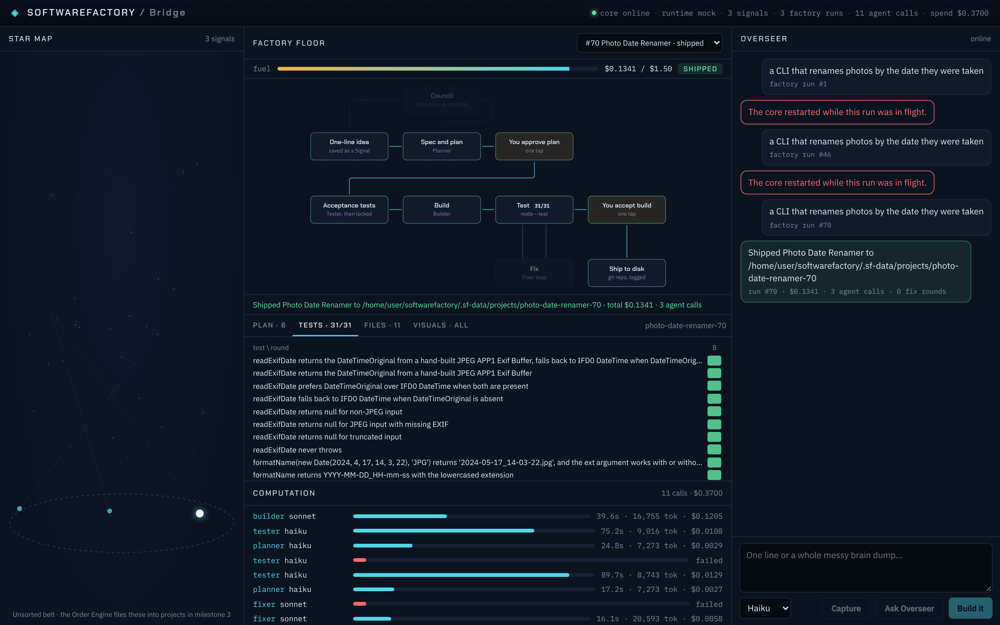

# SoftwareFactory

A loop-engineered software factory with an AI crew. Drop a messy idea in; an Order Engine keeps every thought in its place, and agents working in loops (council, plan, build, test, review, fix) turn it into working software, with as few human approval stops as possible. Everything is visualized.

Plan: [SoftwareFactory: MVP plan and tech stack](https://claude.ai/artifact/9vnEmBfz1VaSGaB1KKwh9H)



## Status: milestone 2 (thin factory loop)

Type a one-line idea in the Overseer channel and press **Build it**. The factory runs:

```
idea → Planner (spec + task graph) → [you approve plan] → Tester (acceptance tests, then locked)
     → Builder → node --test ⇄ Fixer (max 5 rounds) → [you accept build] → git repo on disk, tagged v0.1.0
```

- **Loop engine** (`packages/core/src/factory`): every station is a loop with a worker, a verifier, exit criteria and a budget, all written to the event log.
- **Guards**: the Tester writes the tests from the spec before any code exists, and the core refuses any later write to `test/` and re-checks a hash of the tests before every run. One hard money cap per run. The same failures twice in a row, a station error or a spent budget stops at an escalation card instead of burning rounds.
- **Cheap agents**: agents run with no tools (lean profile) and answer in a strict file format; the core writes the files and runs the tests itself, inside the project folder only, with a scrubbed environment.
- **visualizeEverything in code**: before a station may pass, the core checks that every thing it produced has the event its Bridge view draws from (floor box, timeline pulse, task graph, test grid, file heat map). A missing visual fails the station.
- **Bridge**: the factory floor lights up per station with the fix-round counter and a fuel bar for the run budget; gates show an Approve / Send back bar; the run deck shows the plan as a task graph, tests as a pass and fail grid per round, files as a heat map (locked tests in amber), and every visual check.
- **Headless**: `npm run factory -- "<idea>"` runs the loop with both gates approved for you and prints the total cost. First real result: [docs/milestone-2-run.md](docs/milestone-2-run.md).

## Milestone 1 (skeleton and runtime spike)

- **Bridge UI** (`apps/bridge`): React + TypeScript. Star map (every Signal is a star in the Unsorted belt), factory floor (the 9 stations, React Flow), computation timeline (every agent call with model, time, tokens and cost), Overseer channel.
- **Core** (`packages/core`): TypeScript. Append-only SQLite event log with full-text search, Signals, the `AgentRuntime` adapter with per-call budget caps, a small JSON API and a live event stream.
- **Shell** (`src-tauri`): Tauri 2. Opens the Bridge and runs the core as a child process.
- **Skill** (`skills/visualize-everything`): the visualizeEverything station step.
- **Spike**: [docs/spike-runtime.md](docs/spike-runtime.md). Headless Claude Code in a lean profile costs about $0.0014 per short call on Haiku, versus about $0.99 with every plugin loaded on the default model.

## Run it

Needs Node 22+ and the Claude Code CLI signed in. For the desktop app, also Rust and the [Tauri prerequisites](https://tauri.app/start/prerequisites/).

```bash
npm install
npm test                 # core tests

# In the browser (two processes: core on :4317, UI on :5173)
SF_RUNTIME=claude-code npm run dev -w @sf/core
npm run dev -w @sf/bridge
# open http://127.0.0.1:5173

# As a desktop app
npm run app

# Run the factory loop headless (real, capped model calls; gates auto-approved)
SF_RUNTIME=claude-code npm run factory -- "a CLI that renames photos by the date they were taken" --max-usd 1.5

# Re-run the runtime cost spike (makes a few real, capped model calls)
npm run spike
```

`SF_RUNTIME=mock` (the default for the Bridge) runs without any model calls: its crew builds a tiny word counter with a planted bug, so you can watch the whole loop, fix round included, for free. `SF_RUNTIME=claude-code:full` loads every installed plugin.
