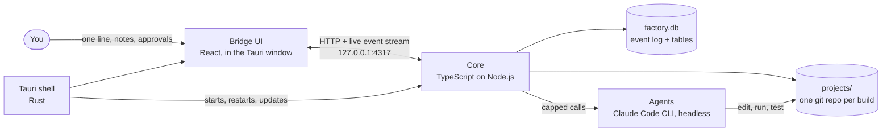

# SoftwareFactory documentation

This folder is the system of record for SoftwareFactory (SF). Every document describes the app **as it is in the code on `main`**. Anything that is planned but not built is marked **Planned** and listed in [spec.md](spec.md).

Last checked against the code: 2026-11-14 (`main` at #84, installed app v0.2.251).

## Start here

| If you want to know | Read |
|---|---|
| What the product is, what it must do, and what is built or still planned | [spec.md](spec.md) |
| Every screen, tab and control of the app | [app.md](app.md) |
| How a person and the app move through the work, as diagrams | [flows.md](flows.md) |
| How the engine turns one line into a shipped app | [engine.md](engine.md) |
| How the code is put together: processes, modules, data | [architecture.md](architecture.md) |
| Every API route, event, table, setting and limit | [reference.md](reference.md) |
| How to set up, test, change and release SF | [development.md](development.md) |

## The whole thing in one picture

## All documents

### Product and app

| Document | What it covers | State |
|---|---|---|
| [spec.md](spec.md) | Vision, principles, requirements with built / partial / planned, limits, non-goals | current |
| [app.md](app.md) | The shell, every page, every project tab, the run views, Systems, shortcuts | current |
| [flows.md](flows.md) | User flows and app flows, as diagrams | current |
| [design.md](design.md) | The Foundry Glass design system: colour, type, motion, shared components | current, written phase by phase |
| [ui-tour.md](ui-tour.md) | The screenshot tour that guards visual changes | current |

### The engine

| Document | What it covers | State |
|---|---|---|
| [engine.md](engine.md) | The pipeline today, then why each part exists (run by run) | current; the top section is the summary |
| [loop-engineering.md](loop-engineering.md) | The research behind the engine: loop, harness and agentic engineering | research note of 2026-11-13; its "what SF is missing" table is history, all three gaps are built |
| [apps.md](apps.md) | The Brain, the app kit and the app check: why builds are real programs | current |
| [screens.md](screens.md) | Every project has a screen; adding a screen to a finished project | current |
| [mcp-safety.md](mcp-safety.md) | The safety rule for agents' MCP servers | current |
| [watchers.md](watchers.md) | Watchers that only open tickets; monthly budgets, the burn rate, and a queue that fits them | current (phase 6) |
| [flows-improve.md](flows-improve.md) | Flows that improve themselves: proposals, replay on past runs, one live trial | current (phase 5) |
| [agents.md](agents.md) | Named agents: who works each flow step, each agent's memory and its cleaning | current (phase 4) |
| [git.md](git.md) | The git manager: local first, merge policy, outside work, versions | current (phase 3) |

### Parts of the app

| Document | What it covers | State |
|---|---|---|
| [projects.md](projects.md) | The project model, project chats, money limits | current |
| [tickets.md](tickets.md) | Tickets, the ready queue, crew pull requests | current |
| [improve.md](improve.md) | The Improvement Council | current |
| [review.md](review.md) | Deep review of an imported repo: run it, read it, verdict, next steps, interview | current |
| [run.md](run.md) | Running a finished project from the app (the Use tab) | current |
| [integrations.md](integrations.md) | Adding a finished project into SF (Finished apps) | current |
| [plugins.md](plugins.md) | Add-ons: the plugin format, permissions, sandbox | current |
| [bases.md](bases.md) | Several factories in one app | current |
| [feature-map.md](feature-map.md) | One record per feature, the wiring map read from the code, proof of life, the check; the Brain as the first case | current |
| [game-door.md](game-door.md) | The three game demos and the Sector direction | demos built; Sector is **Planned** |

### Technical

| Document | What it covers | State |
|---|---|---|
| [architecture.md](architecture.md) | Processes, modules, data flow, safety boundaries, build and release | current |
| [reference.md](reference.md) | API routes, events, tables, environment variables, limits | current |
| [storage.md](storage.md) | Database, files, cache; projections; resuming runs | current |
| [updates.md](updates.md) | In-app updates and the updater key | current |
| [runners.md](runners.md) | Build runners: GitHub's checks and builds on your own PC | current |
| [development.md](development.md) | Setup, tests, CI, how to add things, working rules | current |
| [dogfood.md](dogfood.md) | Judging SF by using the installed app | current |

### History

| Document | What it covers |
|---|---|
| [history.md](history.md) | Milestones 1 to 5, as they were announced |
| [milestone-2-run.md](milestone-2-run.md), [milestone-3-run.md](milestone-3-run.md), [milestone-4-run.md](milestone-4-run.md) | First real runs of each milestone |
| [spike-runtime.md](spike-runtime.md), [spike-runtime-results.md](spike-runtime-results.md) | The milestone 1 spike that chose the agent runtime |

## Words used everywhere

| Word | Meaning |
|---|---|
| **Base** | One whole factory in its own folder: database, projects, settings. The app hosts several and opens one at a time. |
| **Bridge** | The UI (`apps/bridge`). Also "Factory Bridge", the dashboard page inside it. |
| **Core** | The TypeScript process that holds the data and runs the loops (`packages/core`). |
| **Shell** | The Tauri (Rust) desktop wrapper that opens the window and runs the core. |
| **Signal** | Anything you say or drop into the app, stored raw and never edited. |
| **Order Engine** | Files every Signal as fragments under project ▸ idea ▸ thread, and keeps the Canon. |
| **Canon** | The rules and decisions that hold for a node and its parents. Conflicts between them are raised as cards. |
| **Project** | The thing you work on. Runs, ideas, tickets, files and spend all belong to one project. |
| **Run** (or build) | One trip of an idea through the engine. Its id is the id of its `factory.run.started` event. |
| **Station** | One step of a run with a worker, a check and a budget: council, discover, plan, tests, build, test, fix, review, evaluate, ship. |
| **Gate** | A stop that waits for you: gate A (approve the plan), gate B (accept the build), or an escalation. |
| **Crew** | The agents working the stations. **Practice crew**: free canned agents. **Real crew**: Claude Code. |
| **Agent Bay** | Where agents are created, edited, versioned, tested and assigned to stations ("Agents" in the sidebar). |
| **Brain** | The principles every agent on a station is given, editable in the app. |
| **App kit** | The small server, data layer and UI shell every built app stands on (`packages/core/kit`). |
| **Workbench** | A Builder or Fixer session with file tools and an allowlisted shell inside the build folder. |
| **Locked tests** | Acceptance tests written before the code. After locking, no agent may change them. |
| **Product documents** | Brief, journeys, screens and requirements written by the Designer before any plan. |
| **Product judge** | An agent that reads the running app's screens and scores it as a product. |
| **Engine cycle** | The same prompt built again after engine changes, compared side by side. |
| **Ticket** | One unit of work on a project. The crew can work it and return a branch or a draft pull request. |
| **Improvement Council** | Lens agents that propose improvements to your projects and to SF itself. |
| **Finished app** | A shipped project installed into SF as a tool, a panel or a plugin. |
| **Add-on** | A plugin: a folder with `plugin.json` that adds tabs, a backend or agents. |

## Keeping this folder true

- A change to behaviour updates its document in the same pull request.
- A new document gets a row in the tables above.
- Write what the code does. Mark what is not built as **Planned**, in [spec.md](spec.md) and nowhere else as fact.
- Private code from other apps of Assaf's never enters this repository, in documents either.
