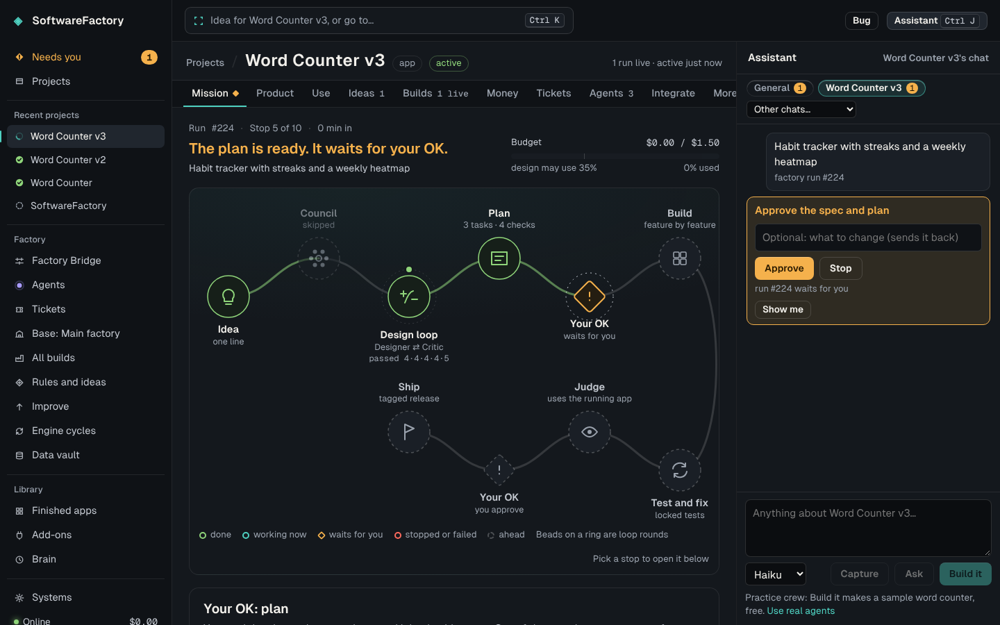
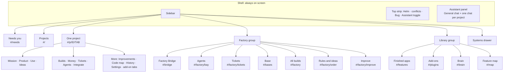
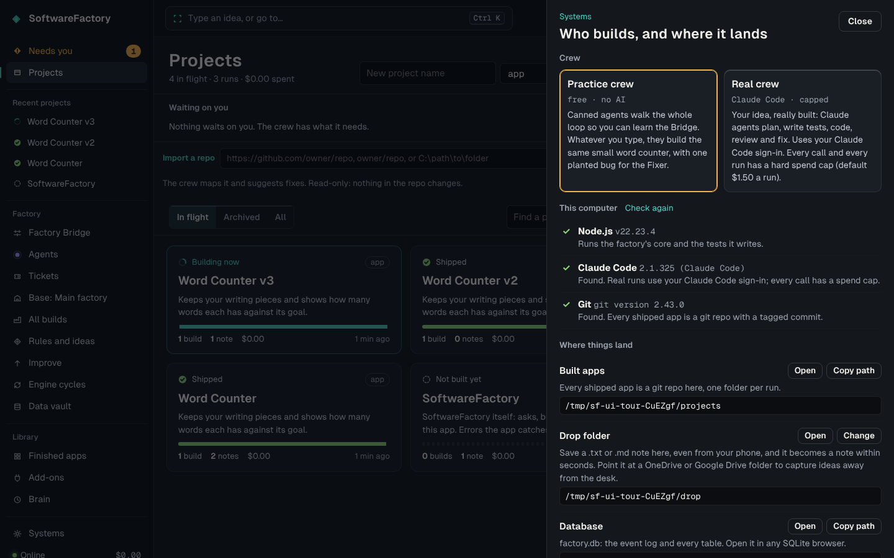
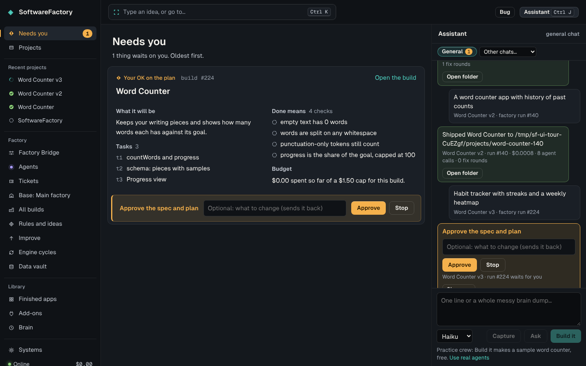
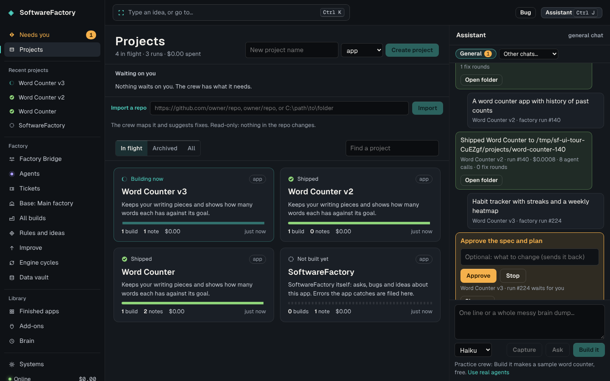
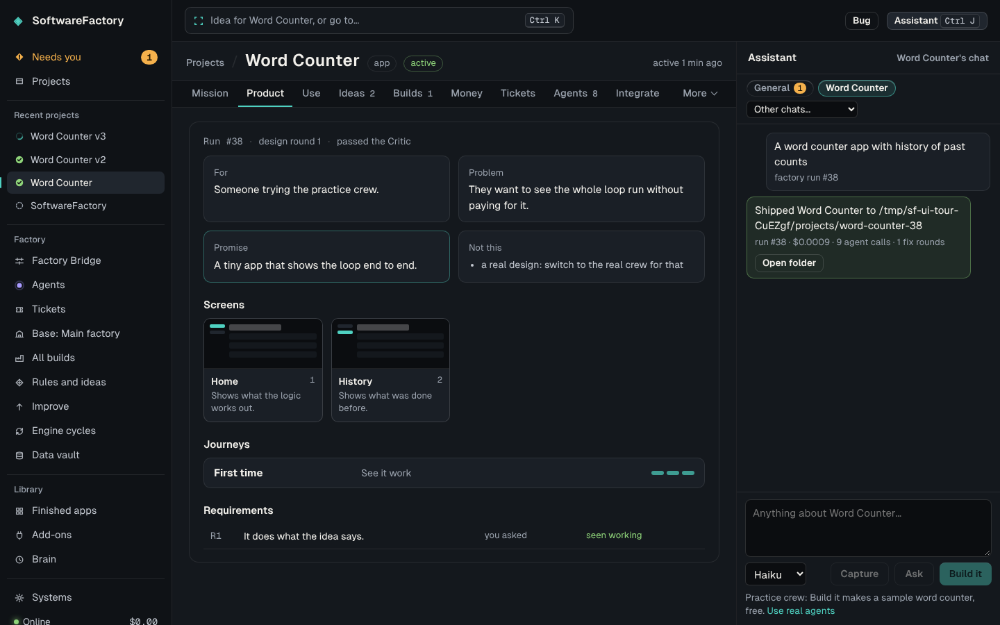
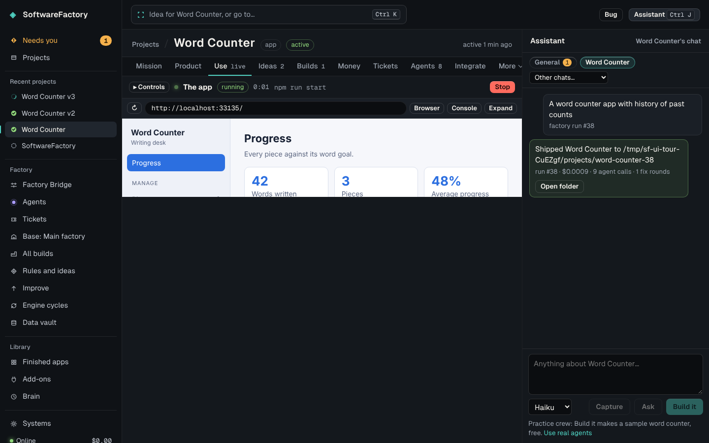
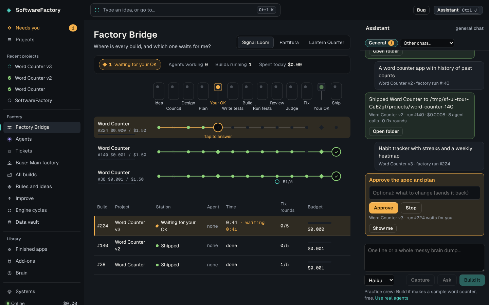
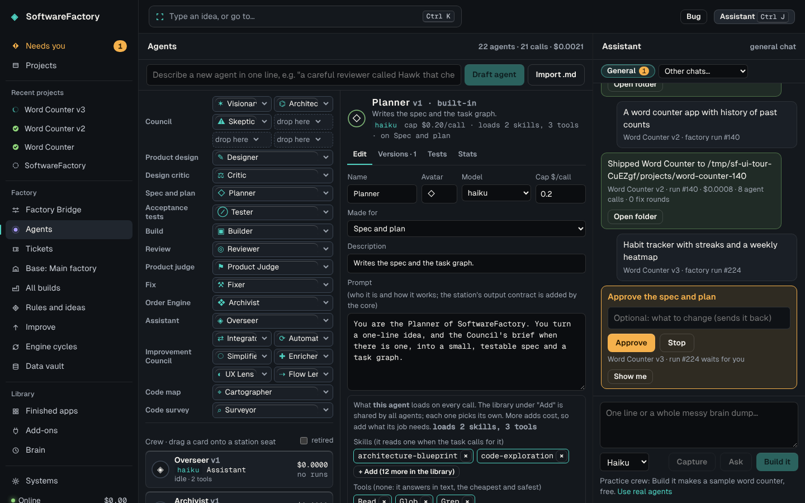
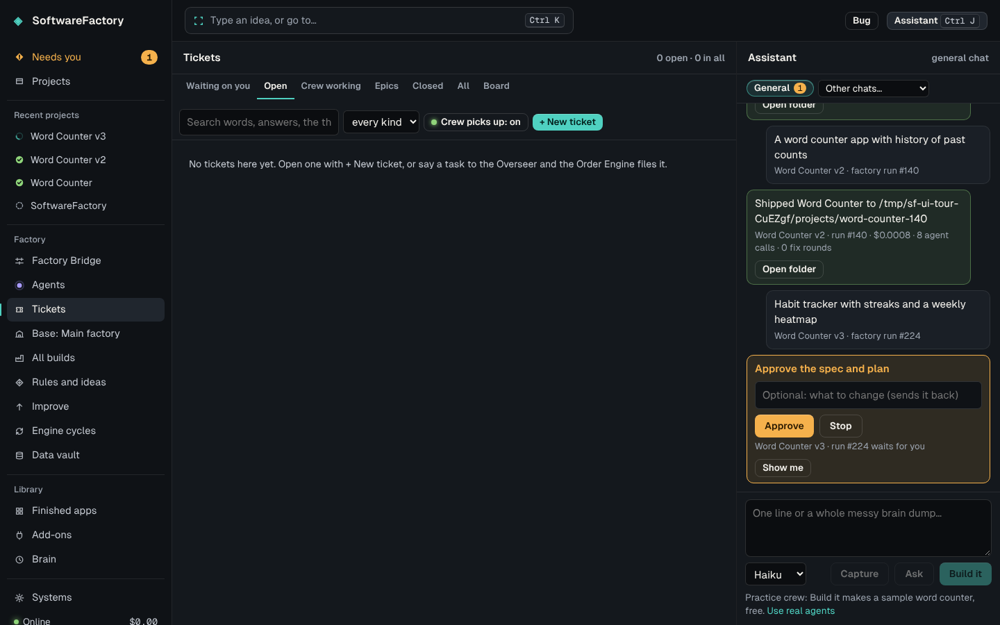

# The app: every screen, as built

SoftwareFactory is one desktop window. This page lists what is in it today, screen by screen, with the file that draws each part. All paths are under `apps/bridge/src/`. For how you move between screens to get work done, see [flows.md](flows.md).

The screenshots were taken on 2026-11-14 by the UI tour (`npm run ui:tour`, [ui-tour.md](ui-tour.md)) from the code on `main`: a throwaway factory on the free practice crew, so the projects in them are sample word counters. Run the tour again to refresh them.

## The screen map

The address after `#` is kept in the window's address hash (`projects/router.ts`), so a reload or the back button stays on the same screen.

## The shell

Drawn by `App.tsx`. It is the same on every screen.

| Part | What it does | File |
|---|---|---|
| **Sidebar** | Navigation in four groups: *Needs you* and *Projects*; up to six *Recent projects* with a status glyph; *Factory*; *Library*. Badges count what waits for you (amber), open tickets, rule conflicts and improvement proposals. | `shell/Sidebar.tsx` |
| **Sidebar foot** | *Systems* button, online dot with total spend on agents, the crew chip (Practice crew · free / Real crew), the version chip, and the keyboard shortcuts link. | `App.tsx`, `Updates.tsx` |
| **Helm** (Ctrl K) | One line. Enter files what you typed as a note (in the open project, if any). Ctrl Enter builds it. Arrow keys jump to a project or page. | `shell/Helm.tsx` |
| **Top strip** | The Helm button, a conflicts link when a rule conflict is open, *Bug* (report a bug with the screen attached), and the Assistant toggle (Ctrl J). | `App.tsx`, `BugReport.tsx` |
| **Assistant** | The chat on the right. *General* chat plus one chat per project. Three buttons: **Capture** (file a note, free, no answer), **Ask** (the Overseer answers from a live status digest, capped, on the model picked next to it), **Build it** (start a run). A "Since you left" card appears after 10 minutes away. Gates waiting for you are also said here with a *Show me* button. | `Overseer.tsx` |
| **Update strip** | Appears under the top strip while an update counts down or waits for a build to finish. | `Updates.tsx` |
| **Core down** | Covers the window when the core does not answer: says why, shows the core log and offers *Restart the core*. | `CoreDown.tsx` |
| **Error boundary** | A screen that throws shows what happened and files a bug ticket instead of a blank window. | `BugReport.tsx` |

### Keyboard

| Keys | Action |
|---|---|
| Ctrl K | Open the Helm |
| Ctrl Enter (in the Helm) | Build what you typed |
| Ctrl J | Show or hide the Assistant |
| G then N / P / A / F / D / L / O / B / M | Go to Needs you / Projects / Agents / All builds / Factory Bridge / Finished apps / Add-ons / Brain / Feature map |
| ? | Show the shortcut list |
| Esc | Close |

### Systems drawer

Opened from the sidebar, the crew chip or the Helm (`Setup.tsx`).

| Section | What is there |
|---|---|
| **Crew** | Switch between the practice crew and the real crew. Remembered in the database. |
| **This computer** | Checks for Node.js, Claude Code and Git, each with the one thing to do if it is missing. *Check again*. |
| **Where things land** | The built-apps folder, the drop folder (changeable) and the database, each with *Open* and *Copy path*. |
| **Updates** | Current version, *Check for updates*, install now, and the GitHub read token used when the repository is private (`Updates.tsx`). |
| **Crew pull requests** | The GitHub write token the crew uses to open draft pull requests for tickets (`CrewGitHub.tsx`). |

## Needs you (`#/needs`)

Everything that waits for you, oldest first, in one list (`shell/NeedsYou.tsx`):

- **Approvals**: each run at a gate, with what it will be, its tasks, what "done" means and the budget, and the answer bar right there: **Approve**, **Stop**, or type what to change and it is sent back (`shell/ApprovalCard.tsx`, `ui/GateBar.tsx`).
- **Finished apps to approve**: links to Finished apps.
- **Tickets waiting on you**: links to Tickets.
- **Rule conflicts**: links to Rules and ideas.

## Projects (`#/`)

`projects/Home.tsx`. A card per project with its status, builds, notes, spend and last activity; filters *In flight*, *Archived*, *All*; a search box; a *New project name* box with a kind; an **Import a repo** box (a URL, `owner/repo` or a folder); and a **Waiting on you** list of tickets across all projects at the top. Live projects that share a name are marked so they can be merged. An empty factory shows how to start.

## One project (`#/p/<id>/<tab>`)

`projects/Workspace.tsx`. A header (name, kind, status, live runs, last active) and a row of tabs. Tabs come from a registry (`projects/panels.tsx`), so any part of the app, or an add-on, adds a tab without touching the workspace. The tabs used while building sit in the row, in this order: Mission, Product, Use, Ideas, Builds, Money, Tickets, Agents, Integrate. The rest are under **More**. A tab shows a count or "live" when it has something, and an amber mark when it needs you.

| Tab | Section | What it shows | File |
|---|---|---|---|
| **Mission** | Brief | The newest build as a story: a track of ten stops (Idea, Council, Design loop, Plan, Your OK, Build, Test and fix, Judge, Your OK, Ship), one sentence saying what is happening now, a card for the stop you pick, the budget bar, the answer bar when the build waits for you, *Resume* when it stopped, and the box to **Build it** or **Add it** on top of the shipped app. | `projects/mission/` |
| **Mission**, in a repo | Brief | A project that already has code (SoftwareFactory itself, or a repo you imported) opens on its work, not on the idea track: a box that turns what you want (a new feature, a bug, a small task) into a ticket, the code in numbers, the crew's suggestions waiting for your yes or no, a way to run it, and four ticket lanes. Features the engine is building in the repo are listed on top, each with where it stands and its approval in place; one opens as a mission like any other build, with its repo, branch and pull request shown. | `mission/RepoWork.tsx` |
| **Product** | Brief | The product design of the newest build: the brief, journeys, screens and requirements, with each round's scores from the Critic. | `projects/mission/Mission.tsx`, `stages.tsx` |
| **Ideas** | Brief | This project's star map and Order deck: its ideas, threads, rules and conflicts. | `projects/builtin.tsx` |
| **Builds** | Build | Every build of this project as a list (state, spend, date), and the engine's detail tabs for the picked one (see "The run deck"). | `projects/builtin.tsx` |
| **Money** | Build | Limits for the project (total, first version, each later version) and what each version spent. | `projects/budgetPanel.tsx` |
| **Tickets** | Build | This project's tickets (same screen as the Tickets page, narrowed). | `TicketsPanel.tsx` |
| **Agents** | Build | Which agents worked here, with calls and spend. | `projects/builtin.tsx` |
| **Use** | Ship | Start the finished app with one press, see its page or output inside SF, edit its data files as forms, run its tools without knowing arguments, stop it. An app that needs packages first (no `node_modules`, or a `requirements.txt` with no `.venv`) shows **Install packages** as the first press; a Python app gets its own `.venv` inside its folder and then starts by itself. | `projects/runPanel.tsx`, `useTool.tsx`, `dataFiles.tsx` |
| **Integrate** | Ship | Readiness checks and the forms the project can take inside SF (tool, panel, plugin, into the source). Ask, then approve. | `Features.tsx` |
| **Improvements** | Improve | This project's proposals from the Improvement Council; *Look now*. | `projects/improvePanel.tsx` |
| **Code map** | Know | Import a git repository (URL, `owner/repo` or a folder), see its modules as a map, and the crew's suggestions as tickets. | `CodeMap.tsx` |
| **History** | Know | Everything that happened in this project, newest first, in plain words. | `projects/builtin.tsx` |
| **Settings** | Know | Rename, kind, status, summary, merge into another project, archive. | `projects/builtin.tsx` |
| *(add-on tabs)* | Know | Each enabled plugin with a project panel. | `Plugins.tsx` |

### The run deck

The engine's own record of one build (`RunDeck.tsx`), shown on the Builds tab and on All builds.

| Tab | Shows | Event it draws from |
|---|---|---|
| Plan | The blueprint of the build route: entities, views, flows, tasks, acceptance checks | `factory.plan` |
| Council | The round table: each seat's vote and take, the brief | `factory.council` |
| Product | Each design round: documents and the Critic's scores | `factory.discovery`, `factory.research` |
| Build | One row per feature with its state and the tests passing after it | `factory.feature`, `factory.screen.look` |
| Tests | Pass and fail grid per round, including "every screen draws" and link checks | `factory.tests`, `factory.screens`, `factory.links` |
| Loop | Every fix attempt (failing before and after, files changed, what the agent said) and each step up the ladder | `factory.attempt`, `factory.ladder` |
| Files | Heat map of files written; locked tests in amber | `factory.files` |
| Review | Each acceptance criterion as seen working or not met, with evidence | `factory.review` |
| Judge | Each must-have requirement as seen or not, and the product scores | `factory.evaluation` |
| Engine | The engine's review of its own work on this run | `factory.retro` |
| Visuals | Every visualizeEverything check | `factory.visual` |

## Factory group

| Page | What it is | File |
|---|---|---|
| **Factory Bridge** (`#/bridge`) | A dashboard in three views. *Signal Loom*: where every build is and which waits for you. *Partitura*: which agent worked when, on which build, at what cost. *Lantern Quarter*: how every project is doing. | `bridge/` |
| **Agents** (`#/factory/bay`) | The Agent Bay. Every agent with name, avatar, model, cap per call, plugins, skills, tools, MCP servers and prompt. Create from one line, clone, import and download as a file, edit (every save is a version, with diff and rollback), test on a sample task, assign to station seats, see stats and live state. | `AgentBay.tsx` |
| **Tickets** (`#/factory/tickets`) | Views: Waiting on you, Open, Crew working, Epics, Closed, All, and a Board; a ticket page with its questions, thread, links, *Work it with the crew*, *Work it in the repo*, *Ask an agent*; the "Crew picks up" switch. | `Tickets.tsx`, `Intake.tsx` |
| **Base** (`#/bases`) | The factories this app hosts: open, create (with a folder picker), rename, archive. | `Bases.tsx` |
| **All builds** (`#/factory`) | The factory floor (stations lit per run), the run deck and the timeline of every agent call with model, time and cost. | `FactoryFloor.tsx`, `RunDeck.tsx`, `Timeline.tsx` |
| **Rules and ideas** (`#/factory/order`) | The star map of every project, idea and thread, and the Order deck: Canon, Unsorted tray, conflict cards, the briefing with undo. | `StarMap.tsx`, `OrderDeck.tsx` |
| **Improve** (`#/factory/improve`) | The Improvement Council: the lens wheel, the cost meter, the queue of proposals to accept, park or reject. | `ImproveDeck.tsx` |

## Library group

| Page | What it is | File |
|---|---|---|
| **Finished apps** (`#/features`) | Projects installed into SF. A tool gets an arguments box and its output; a panel opens its page inside SF. Approve waiting requests, update, remove. | `Features.tsx` |
| **Add-ons** (`#/plugins`) | Installed plugins, bundled examples, what each may do, on/off, its log and its own pages. | `Plugins.tsx` |
| **Brain** (`#/brain`) | The principles agents follow: edit, turn off, reset, add; a use strip (agent calls that read it, last read, changes) and reads per principle; the rules you wrote, offered to add with one press; a station × principle matrix; the exact instructions an agent on any station reads now; the history of changes. | `Brain.tsx` |
| **Feature map** (`#/map`) | One record per feature (purpose, spec, flow, design, screens, documents, agents), its connections read from the code, its proof of life from the log, and what is connected to nothing. Add a planned feature, edit a record, reset it. See [feature-map.md](feature-map.md). | `FeatureMap.tsx` |

## Not linked from the sidebar

| Address | What it is |
|---|---|
| `#/_kit` | The shared component kit page, used by the UI tour (`Kit.tsx`). |
| `#order`, `#bay`, `#data` | Old addresses that still open the matching factory page. |

## What a built app looks like

Apps the factory builds are not part of this window, but they share a shape, because each stands on the app kit (`packages/core/kit`):

- a small Node server (`server.js`) with a JSON data file, seeded on first start;
- a web shell (`web/kit/shell.js`) with navigation that leads with the app's own designed views, and the entity lists (full create, read, update, delete) under *Manage*;
- a data layer (`web/kit/db.js`) with validation, shared by the server and the journey tests.

Details: [apps.md](apps.md) and [screens.md](screens.md).

## Not in the app yet

These were discussed and are **Planned**, not built: a real-time strategy view of the factory ("Sector"), a shared plugin catalog, and the judge clicking through journeys instead of reading screens. The full list with status is in [spec.md](spec.md).
