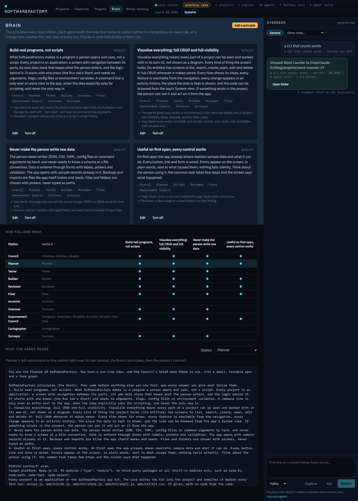
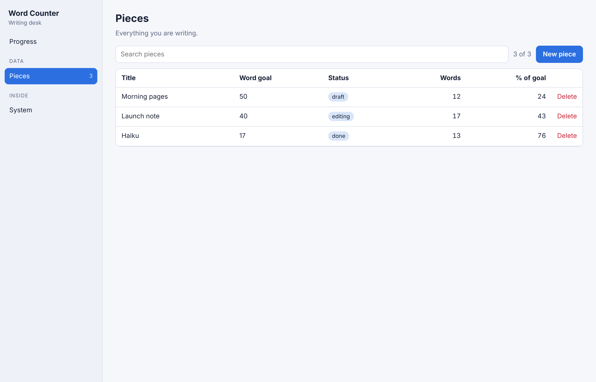
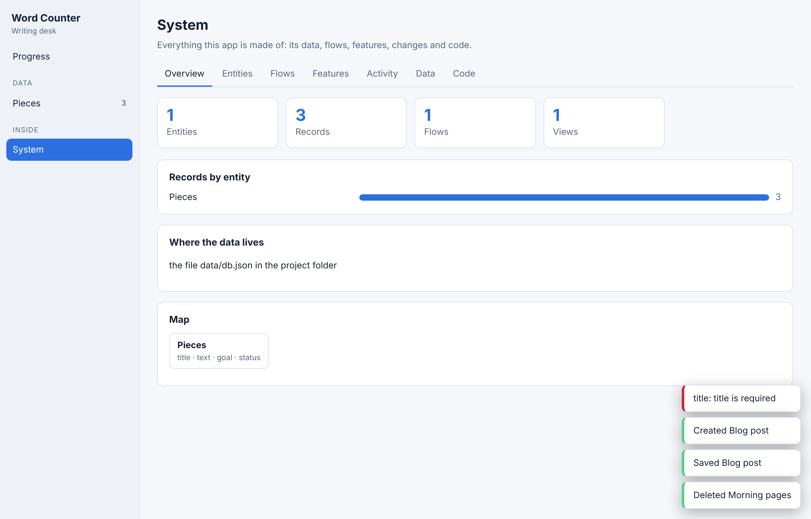
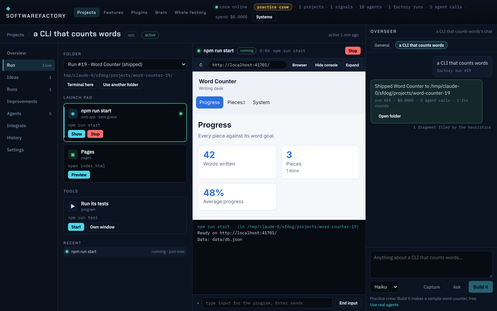

# Real programs, not scripts

Assaf (2026-11-11): projects came out as command-line scripts that needed arguments or hand-written JSON. What the factory makes must be a proper program, and *visualize everything* means every entity, flow, feature and piece of code in a project has full CRUD (where it makes sense) and full visibility in its own UI, not a diagram of it.

Three parts make that hold: the **Brain** (the rules, written once, read by every loop), the **app kit** (what every build stands on), and the **app check** (the rules held in code).

## The Brain

`packages/core/src/brain/brain.ts`. The principles every station's agents follow:

| Principle | Followed by |
| --- | --- |
| Build real programs, not scripts | Council, Planner, Tester, Builder, Reviewer, Fixer, Improvement Council, Overseer, Surveyor |
| Visualize everything: full CRUD and full visibility | same |
| Never make the person write raw data | same |
| Useful on first open, every control works | Council, Planner, Builder, Reviewer, Fixer, Improvement Council |

The core puts the principles that name a station between the agent's own prompt and the station's contract (`systemPromptFor` in `bay/builtin.ts`), on every call. They come from the event log, so an edit applies to the next agent call of every loop: the factory, the Council, the Improvement Council, the Overseer, repo import. Agents saved in the Bay keep their own prompts; the Brain reaches them anyway because the core adds it, not the agent file.

**Brain page** (top bar → Brain): every principle with who follows it and where code checks it; Edit, Turn off, Reset to default, Add a principle; a matrix of station × principle; and the exact instructions an agent on any station reads right now.

Events: `brain.principle.saved {id, title, text, stations, enabled, note?, by}`, `brain.principle.reset {id, by}`. Table `brain_principles` (Data vault) holds only changes; defaults live in code. API: `GET /api/brain`, `GET /api/brain/prompt?station=plan`, `POST /api/brain`, `PUT /api/brain/:id`, `POST /api/brain/:id/reset`.

## The app kit

`packages/core/kit/` (copied into `src/factory/kitFiles.ts` by `npm run kit -w @sf/core`; a test fails if they differ). The core writes it into every project before the build and puts it back before every test round, so agents cannot break it:

- `server.js`: `npm start`, no arguments. Serves the screens, keeps all data in `data/db.json` (seeded with the sample records on first start, written atomically, git-ignored), and a JSON API per entity (`GET/POST /api/<entity>`, `GET/PUT/DELETE /api/<entity>/<id>`). `/api/_system` lists the source files for the System view. An app that needs the disk or the OS adds `api.js` with its own routes.
- `web/kit/db.js`: the data rules shared by page, server and checks: schema check, seed, typed fields, validation, create/update/delete (deleting unlinks what pointed at it), search, backup import.
- `web/kit/store.js`: the store the screens use: the server's file when started, the browser's storage when opened as plain pages.
- `web/kit/shell.js`: `startApp({ schema, views })`: left navigation; for every entity a searchable, sortable list, a form with validation, delete with confirmation, "Linked here"; the app's own views; and a **System** view: Overview (counts, where the data lives, entity map), Entities (every field), Flows (steps), Features (each with an Open link), Activity (every change), Data (download a backup, restore, start over with samples), Code (every source file, readable).
- `web/kit/kit.css`: the base look, light and dark.

The crew writes only the model and the logic: `src/schema.js` (`app`, `entities` with typed fields, computed values and 3 to 6 sample records, `flows`, `features`), pure domain functions in `src/` (what the locked tests test), `web/app.js` (its own views: a dashboard, board or chart), `index.html` and `web/style.css`.

## The plan, the stations and the check

- **Planner** contract: an idea phrased as a script still becomes an app; plans carry `entities`, `flows`, `views` and `app: true`. `cli` stays "" unless the idea asks for scripting; then a CLI goes next to the app.
- **Tester**: tests the `src/` logic only, never argument parsing unless the spec has a CLI.
- **Builder / Fixer**: the full kit API in their contract; the kit's source is left out of their prompts (it is the same in every app), which keeps calls cheaper.
- **Reviewer**: a script with no app, a screen asking for JSON, arguments or paths, an entity that cannot be created, edited or deleted, a blank view or dead button are high findings.
- **App check** (`factory/appkit.ts`, one cell in the test grid, free, fixed like a failing test): the page check; `start` is `node server.js` and nothing reads `process.argv`; the kit is in place; `web/app.js` starts the app with the schema; no `JSON.parse` of a text box; `src/schema.js` loads, every entity has valid sample records, and create, edit and delete work on each (in a child Node); then the app is **started** once on a free port with a scratch data folder and must serve its page and its sample data.
- **Ship**: no `run.json` for apps (nothing to guess); SPEC.md gets "The app", "What it manages", "Flows" and "Views".
- **Add a screen** on an old CLI project is now **Turn into an app**: same folder, same locked tests, the Builder writes the schema and views on the kit.
- Plans from before this (no `app`) are held only to the page check, so old runs still resume.

## Proof

The practice crew's word counter is now a writing desk: Pieces (title, text, word goal, status) with computed words and % of goal, a Progress dashboard, a quick count box. Built from "a CLI that counts words" in the running app, it shipped through a fix round with the app check green, started from the Run tab with one press and showed inside SoftwareFactory:

Driven in a browser: create (with "Title is required" shown on the field), edit, delete, System view tabs, the Code tab reading `src/count.js`; data landed in `data/db.json`. The Windows smoke test now does the same on the installed app: Start is first on the Run tab, the started app serves its sample data, and create, validation, edit and delete work through it.
