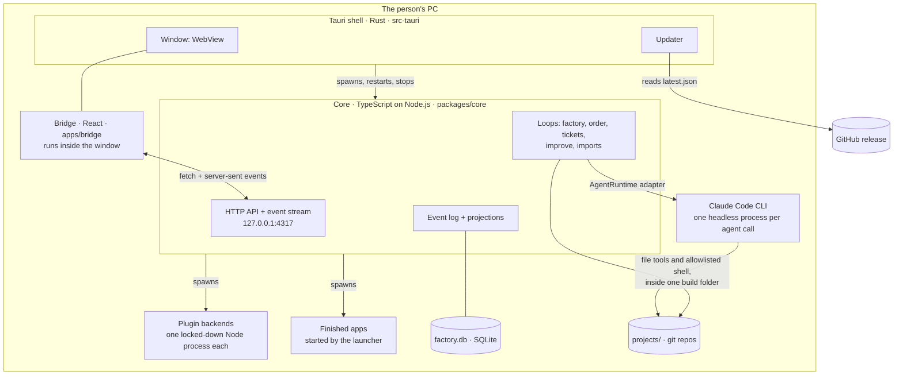
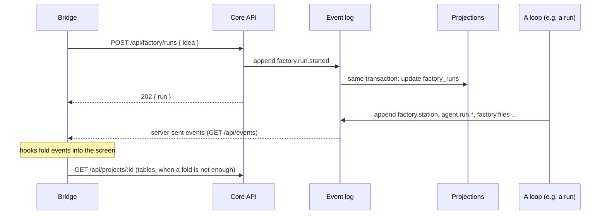
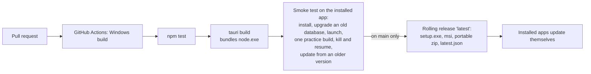

# Architecture

How SoftwareFactory is put together: the processes, the modules, how data moves, where the safety boundaries are, and how a build reaches a PC. Exact routes, events and tables are in [reference.md](reference.md).

## Three processes and a CLI

| Process | Language | Job | Lives in |
|---|---|---|---|
| **Shell** | Rust (Tauri 2) | Opens the window, finds Node.js and the Claude CLI, starts the core as a child, restarts it, shows why it is down, installs updates | `src-tauri/` |
| **Core** | TypeScript, Node.js 22.5+ | Owns all data and every loop; serves the API on `127.0.0.1:4317` | `packages/core/` |
| **Bridge** | TypeScript, React 18, Vite | The UI. Holds no data of its own beyond view choices | `apps/bridge/` |
| **Agents** | Claude Code CLI | One process per call, with a spend cap; killed with its process tree on timeout | started by `runtime.ts` |

Rust is kept to the shell. The decision of 2026-11-10 was a Tauri shell with a TypeScript core, and Rust grows only where the shell needs it.

The core exits by itself when the shell is gone (`SF_PARENT_PID`), so no orphan core keeps the port. Stopping the core stops plugin backends and launched apps.

## The core, module by module

All under `packages/core/src/`.

| Module | Job | Read more |
|---|---|---|
| `events.ts` | The append-only event log (SQLite), full-text search, live listeners | [storage.md](storage.md) |
| `store/` | Schema migrations, projections (tables folded from events), cache, the Data vault report | [storage.md](storage.md) |
| `server.ts` | The HTTP server, routing, the live event stream, start-up of one base | [reference.md](reference.md) |
| `bases/` | The registry of bases and the host that switches between them | [bases.md](bases.md) |
| `runtime.ts`, `agents.ts` | The `AgentRuntime` adapter: Claude Code (lean or full), the mock practice crew, a switchable wrapper; per-call caps, timeouts, cost recording | [spike-runtime.md](spike-runtime.md) |
| `setup.ts` | Checks for Node.js, Claude Code and Git; crew mode | |
| `signals.ts` | Capturing a Signal | |
| `order/` | The Order Engine: Archivist, model, precedence rules, sweep, briefing | [history.md](history.md) (milestone 3) |
| `factory/` | The engine: the run loop and every station | [engine.md](engine.md) |
| `bay/` | The Agent Bay: agent files, versions, slots, tests, the built-in crew, per-agent kits | |
| `brain/` | The principles added to every agent's instructions; recall of the person's own words | [apps.md](apps.md) |
| `safety/` | Fast checks (syntax, types, lint, secrets), the secret scan hook, the locked-test guard | [engine.md](engine.md) |
| `projects/` | Projects, links, adoption of old data, money limits | [projects.md](projects.md) |
| `chat/` | Which chat an item belongs to (General or a project) | [projects.md](projects.md) |
| `tickets/` | Tickets, intake, the ready queue, work in a repository, GitHub pull requests, error capture | [tickets.md](tickets.md) |
| `improve/` | The Improvement Council and its lenses | [improve.md](improve.md) |
| `imports/` | Importing a repository: scan, map, survey, suggestions | |
| `launch/` | Finding how to run a finished project, starting and stopping it, its data files and tools | [run.md](run.md) |
| `integrations/` | Installing a finished project into SF | [integrations.md](integrations.md) |
| `plugins/` | Plugin manifest, host, sandboxed runner, page SDK | [plugins.md](plugins.md) |
| `bridge/` | Things only the UI needs from the core: the status digest, the drop folder, "since you left" | |

Beside `src/`: `kit/` is the app kit copied into every built app; `agent-skills/` are the skills agents may load; `agent-mcp.json` lists the MCP servers offered to agents; `plugin-examples/` ship with the app.

### Inside `factory/`

| File | Job |
|---|---|
| `loop.ts` | `Factory` (start, resume, gates) and `Run` (the station sequence, budgets, escalations, restore from the log) |
| `council.ts` | Seats, votes, the brief |
| `discovery.ts` | Product documents, the Critic's rubric, the design loop's rules |
| `features.ts` | The plan as a feature list; the build loop's budget shares |
| `workbench.ts` | What a Builder or Fixer may run in the build folder |
| `workspace.ts` | Writing files, git, running the tests, reading the results |
| `testcheck.ts` | The dry run of tests before they are locked |
| `stoprules.ts` | When a fix loop must stop; the run's time limit |
| `screencheck.ts`, `uicheck.ts` | Opening every screen in a real browser; the static page check |
| `linkcheck.ts` | Opening every link the app contains |
| `appkit.ts`, `kitFiles.ts` | Installing the kit; checking an app against it |
| `evaluate.ts` | The product judge's rubric, the per-screen look, repair features |
| `retro.ts`, `cycles.ts` | The engine review and the cycle comparison |
| `visualize.ts` | The visualizeEverything check |
| `appagent.ts` | A built app asking one of the person's agents |
| `crew.ts` | Binding an agent to a station: prompt, principles, contract, kit |

## The Bridge

`apps/bridge/src/`. One React app, no router library and no state library.

- `api.ts` holds every call to the core and the hooks that fold the live event stream into view state (`useFactory`, `useOrder`, `useBay`, `useProjects`).
- `projects/router.ts` keeps the place in the address hash.
- `projects/panels.tsx` is the registry of project tabs. A module registers a tab at load time and is imported once from `App.tsx`.
- `shell/` is the frame (sidebar, Helm, Needs you, shortcuts); `ui/` holds shared components; `styles.css` holds the Foundry Glass tokens.

Screen by screen: [app.md](app.md).

## How data moves

Three rules make this hold:

1. **Every change is an event.** Nothing is updated or deleted in the log.
2. **Tables are projections.** Each is updated in the same transaction as its event and can be rebuilt from the log.
3. **A loop keeps no state outside the log.** That is why a run can resume after a crash: `restoreState()` reads it back.

Files are used only for things that are files: the generated repositories under `projects/`, clones under `imports/` and `ticket-work/`, installed copies under `extensions/` and `plugins/`.

### The data folder

In the installed app this is `%APPDATA%\dev.plonter.softwarefactory\`; in development `.sf-data/`.

| Path | Holds |
|---|---|
| `factory.db` (+ `-wal`, `-shm`) | The Main factory base: event log and tables |
| `factory.db.v<N>-<time>.bak` | Backups made before a schema upgrade (newest 3) |
| `bases.db` | The list of bases |
| `projects/` | One git repository per build |
| `imports/`, `ticket-work/` | Clones of imported repositories; clones the crew works tickets in |
| `extensions/`, `plugins/` | Installed finished apps; installed add-ons |
| `agent-kits/` | Each agent's own skills and MCP configuration |
| `core.log`, `core.prev.log` | The core's log for this start and the one before |
| `github-token` | The crew's write token, if set. Never in the database or a log |

Other bases have the same layout in their own folders.

## How an agent call is made

```mermaid
flowchart LR
  st["A station needs a worker"] --> bay["Agent Bay: who sits on this slot,<br/>which version"]
  bay --> bind["bind: agent prompt<br/>+ Brain principles for the station<br/>+ the station's output contract<br/>+ the agent's kit"]
  bind --> cap["Cap = the lowest of: the agent's cap,<br/>what the run has left, the station's share"]
  cap --> rt["AgentRuntime.run"]
  rt --> cli["claude -p, headless:<br/>model, budget, allowed tools,<br/>own MCP config, optional cwd + shell allowlist"]
  cli --> res["Text, cost, tokens, session id"]
  res --> ev["agent.run.completed or failed<br/>cost always counted"]
  ev --> parse["The core parses the contract format<br/>and checks the work itself"]
```

Two profiles exist. **Lean** (the default): no tools, the agent answers in a strict text format and the core writes the files. **Workbench**: file tools plus an allowlisted shell inside one build folder, for the Builder and Fixer. The practice crew is a mock runtime that returns canned answers and costs nothing.

## Safety boundaries

| Boundary | How it is held |
|---|---|
| Network exposure | The core listens on `127.0.0.1` only |
| Money | A cap on every call; a cap on every run; optional project totals; daily caps for the Archivist, the Improvement Council and the ticket queue. A budget rise always asks the person |
| What an agent may run | An allowlist of commands; no package installs, no git changes, no network from the shell |
| What an agent may change | Only its build folder. The core puts back locked tests and the kit after every call |
| Secrets | A scan of every changed file before tests run; a hook refuses to write a secret; the crew's GitHub token is kept in a file outside the database and never reaches a log, a ticket or a prompt |
| Plugin backends | Node's permission model: read its own folder only, no writes, no child processes, no keys in its environment, 128 MB |
| Plugin pages | Sandboxed frames; the core refuses API calls from them; they ask through the Bridge, which checks permissions |
| The person's repositories | Imported repositories are cloned and never written to. Ticket work happens in a separate clone on its own branch. The crew never pushes to main |
| Built apps asking for agents | Only callers on this computer, capped |
| User data | Tests and the smoke run use their own temporary data. Upgrades back up first |

## Build, release and update

- Version: `0.2.<CI run number>`, set at build time. `package.json` and `tauri.conf.json` stay at `0.1.0`.
- The updater artifact is signed with the key in the repository secret `TAURI_SIGNING_PRIVATE_KEY`; the public key is in `src-tauri/tauri.conf.json`. Details: [updates.md](updates.md).
- The installer is not code-signed, so Windows SmartScreen warns on first install.
- Only Windows is built. From source the core and the Bridge run anywhere Node 22.5+ runs.

## Why it is built this way

| Choice | Reason |
|---|---|
| Event log as the source of truth | History, undo, replay and resume come for free; a broken table never loses data |
| A TypeScript core outside the shell | The same core runs headless (CLI, tests, CI) and inside the app; the UI can be developed in a browser against a real core |
| Claude Code CLI behind an adapter | The spike showed a lean headless call costs about a thousandth of a full-profile one; the adapter lets the runtime be swapped |
| The core checks, agents propose | An agent's claim is never the verdict: the core runs tests, opens screens and decides against thresholds |
| Tabs and tables from registries | A new part of the app adds a projection and a project tab without touching shared files |
| Built apps on a fixed kit | Every build starts from a working server, data layer and UI shell, so the money goes into the product |
