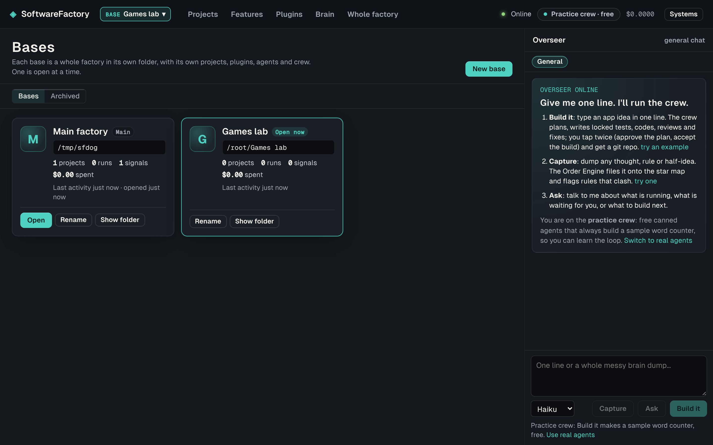

# Bases: several factories in one SoftwareFactory

A **base** is a whole factory in its own folder: its own `factory.db` (event log, projects, tickets, chats, agents, settings and crew mode), `projects/`, `imports/`, `plugins/`, `extensions/` and drop folder. One base is open at a time. Making a new base is like starting a new game; opening another is like loading a save.

## Where things live

| What | Where |
|---|---|
| The list of bases | `bases.db` in the app's home folder (on Windows `%APPDATA%\dev.plonter.softwarefactory\`, in dev `.sf-data/`): an append-only `base_events` log and a `bases` table kept current from it |
| Main factory | The home folder itself. The factory you had before bases existed is adopted in place: nothing moves |
| New bases | `<home>\bases\<name>` by default, or any folder you pick in the folder picker (another drive, a synced folder) |

A folder that already holds a `factory.db` (a base copied from another computer) is added as it is. A folder with other files in it is refused, so a base's files stay on their own.

## In the Bridge

The **BASE** chip next to the logo shows the open base; click it for the Bases screen:

- **New base**: a name, a suggested folder or **Choose another folder…** (walk the folders, no typing; pasting a path also works), and **Open it right away**.
- Each card peeks inside its database: projects, runs, signals, spend, last activity.
- **Open**, **Rename**, **Show folder**, **Archive** / **Bring back**. Archiving only hides a base; its folder is never touched. Main factory cannot be archived, and the open base cannot be archived.

## How switching works

The core (`packages/core/src/bases/host.ts`) answers `/api/bases*` itself and sends every other request to the open base. Switching closes the open base (timers, drop folder, plugins, launched apps, database; event streams end) and boots the other one in the same process on the same port; the Bridge then reloads on the new base's projects. A base with factory runs working is not switched away from: the Bridge says so, and you switch when they finish. The open base is remembered across restarts.

## API

- `GET /api/bases`: `{ current, home, bases: [card], activeRuns }`
- `POST /api/bases` `{ name, folder?, open? }`: make a base (adopts a folder that already has `factory.db`)
- `POST /api/bases/:id/open`, `POST /api/bases/:id` `{ name }`, `POST /api/bases/:id/archive` `{ archived }`, `POST /api/bases/:id/reveal`
- `GET /api/bases/browse?path=`: folders for the picker; `GET /api/bases/suggest?name=`: the default folder for a name
