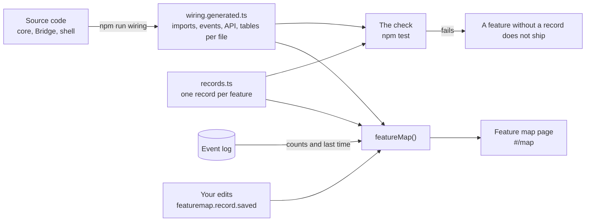
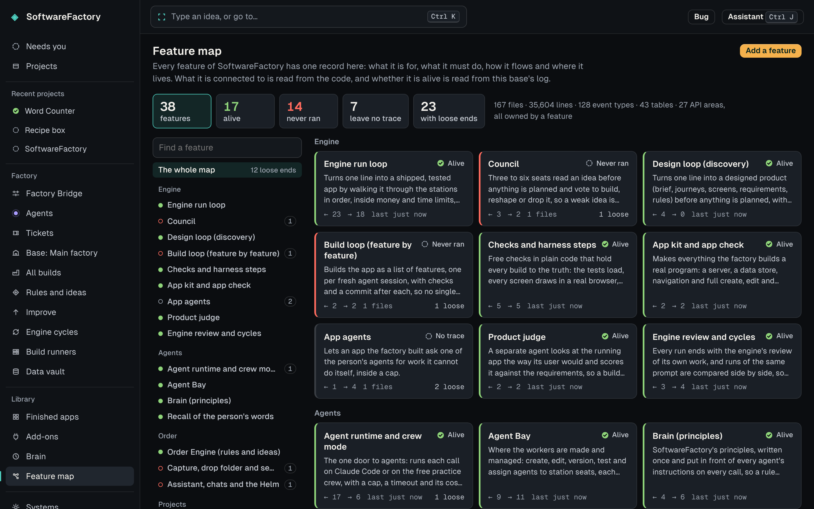
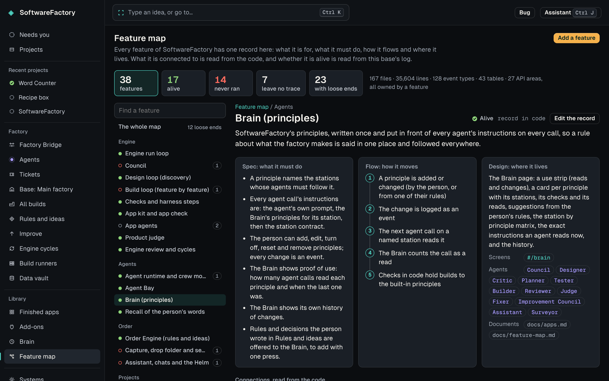

# The feature map: one record per feature, wired from the code

Assaf (2026-11-14): "SF has a brain, but I never saw it change, so I'm not sure it is wired to anything. We need to define every feature, have its docs (spec, flow, design), and make sure our features are connected and in use, in an ordered way: what is wired to what, what is shared."

Three parts answer that: a **record** for every feature, a **wiring map** read from the real code, and **proof of life** from the event log. A **check** in the test run keeps all three true.

## The record

`packages/core/src/featuremap/records.ts`. One entry per feature (38 today), next to the code, so it changes in the same pull request as the feature.

| Field | What it holds |
|---|---|
| `name`, `group` | What it is called and where it sits (Engine, Agents, Order, Projects, Work, Library, App, Foundation) |
| `purpose` | Why it exists, in a sentence or two |
| `spec` | What it must do, one requirement per line |
| `flow` | How it moves, step by step |
| `design` | Where it lives in the app and how it shows itself |
| `screens` | The addresses of its screens |
| `docs` | The documents that describe it in full |
| `stations` | Which stations' agents work in it |
| `files`, `api` | The source folders or files and the API areas it owns |

The record is the short, always-true summary. The long form stays in the document it names (for example [engine.md](engine.md) for the run loop).

In the app a record is edited in a form (**Edit the record**), and a feature that is not built yet is added as a plan (**Add a feature**). Both are events (`featuremap.record.saved`, `featuremap.record.reset`), so they are per base and can be reset to the record in code. `files` and `api` are not edited in the app: they are facts about the code, and the check keeps them true.

## The wiring map

`packages/core/scripts/wiring.mjs` reads every source file under `packages/core/src`, `apps/bridge/src` and `src-tauri/src` and writes `packages/core/src/featuremap/wiring.generated.ts`. For each file:

| It finds | How |
|---|---|
| Which files it imports | relative `import` lines, resolved to real files |
| Which events it writes | the first argument of `append(` or `emit(` |
| Which events it reads | any other use of a known event type, and `startsWith("x.")` as a prefix |
| Which API areas it answers (core) or calls (Bridge) | `/api/<area>` in the text |
| Which tables it creates or queries | `CREATE TABLE`, and `FROM`, `JOIN`, `INTO`, `UPDATE` |

The file is not committed. It is written before every test run, typecheck, build and dev start (the `pre*` scripts in `packages/core/package.json`), so it always matches the code and two pull requests never conflict over it. To write it by hand: `npm run wiring -w @sf/core`.

`featureMap()` (`featuremap/map.ts`) gives every file to the record with the longest matching path, then folds the wiring by feature:

- **A depends on B** when A imports B's files, reads an event B writes, calls an API area B owns, or queries a table B creates.
- **Connected to nothing**: events that are declared but never written, events written but never read by name, API areas no screen calls, and code no record owns.

## Proof of life

For each feature the map counts, in this base's log, the events its files write (plus the events the run loop writes on behalf of a station, listed in `PROOF` in `map.ts`) and the agent calls on its stations. Each feature gets a state:

| State | Meaning |
|---|---|
| **Alive** | Its events are in the log; the page says how many and when the last one was |
| **Never ran** | It is built and would leave events, but none are in this base's log |
| **No trace** | It writes no events (a pure screen, the shell), so the app cannot show when it was used |
| **Planned** | A record the person added, with no code yet |

## The check

`packages/core/test/featuremap.test.ts`, run by `npm test` and so by every build:

1. the wiring is generated from the code as it is now (before every test run and build);
2. every source file belongs to a record, and every API area the core answers is claimed by exactly one record;
3. every record has a purpose, a spec, a flow of two steps or more, a design, and documents that exist; every path and API area it claims is real.

A new module, screen or API area without a record fails the build with a sentence that says what to add and where.

**The same rule in the apps the factory builds.** A built app lists its features in `src/schema.js` as `{ name, purpose, flow, where }`. The Planner's and Builder's contract asks for them (`bay/builtin.ts`), and the app check (`factory/appkit.ts`), which runs at every test round, refuses a build with no features or with a feature that lacks a purpose, a flow of two steps or a place that exists. A failure goes to the Fixer like any failing test. The app's own System view lists each feature with its purpose and steps. This is the engine enforcing the rule; nobody writes these records by hand.

## The Brain, the first case

What was found on 2026-11-14, in the code and in the installed app's data:

- **Read side: wired.** `AgentBay.crewFor` passes the principles to `systemPromptFor`, which puts them between the agent's own prompt and the station contract on every call. The installed app's log held 461 agent calls on the stations the principles name.
- **Write side: nothing but the form.** The only thing that could change the Brain was typing into the Brain page. The log held no `brain.*` event at all. So it never changed.
- **The person's rules did not reach it.** Rules written in Rules and ideas (the Order Engine's Canon) were read by the Improvement Council and the Assistant's digest, but not by the agents that build.

What changed (`brain/learn.ts`, `Brain.tsx`):

- **Use**: the page counts the agent calls that read the Brain, the last read, and reads per principle since its current version.
- **Suggestions from your rules**: every live rule or decision in your own words is offered on the Brain page. *Add to the Brain* makes it a principle (it keeps its source) that the next agent call reads; *Not for the Brain* is remembered. No agent call, no cost.
- **History**: every add, edit, reset and turned-away rule is listed.

Events: `brain.principle.saved` now may carry `source {kind: "rule", fragment, node?}`; `brain.suggestion.dismissed {fragment, text, by}`. API: `POST /api/brain/suggestions/:fragment/accept` and `.../dismiss`; `GET /api/brain` also returns `use` and `suggestions`.

## Adding a feature to SF

1. Write the code.
2. Add its record to `records.ts` (or add its files to the record of the feature it belongs to).
3. `npm test`. The check says what is still missing.
