# Flows

How a person moves through SoftwareFactory, and how the app moves work through itself. Every flow here is built and was read from the code; where a flow has a planned extension it says **Planned**. Screen names are the ones in [app.md](app.md); engine detail is in [engine.md](engine.md).

Contents: [1. First launch](#1-first-launch) · [2. One line to a shipped app](#2-one-line-to-a-shipped-app) · [3. Inside the engine](#3-inside-the-engine) · [4. Where the engine stops for you](#4-where-the-engine-stops-for-you) · [5. A note becomes order](#5-a-note-becomes-order) · [6. A ticket becomes a pull request](#6-a-ticket-becomes-a-pull-request) · [7. Using a finished app](#7-using-a-finished-app) · [8. The next version](#8-the-next-version-of-a-shipped-app) · [9. Import a repository](#9-import-a-repository) · [10. Stop, crash and resume](#10-stop-crash-and-resume) · [11. Updates](#11-updates) · [12. Engine cycle](#12-an-engine-cycle)

## 1. First launch

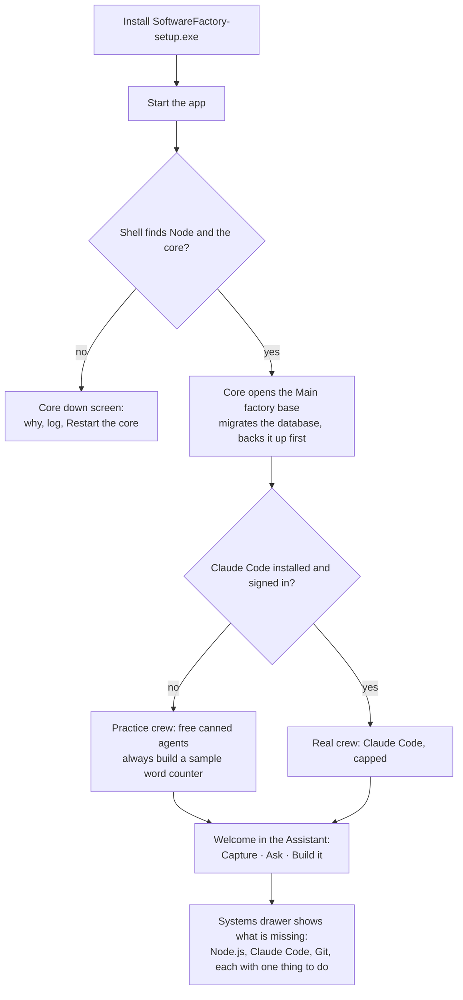

Git is needed before anything can be built, because every build is a git repository. Without it *Build it* answers with the install link.

## 2. One line to a shipped app

What the person does. Two taps are required; everything else runs by itself.

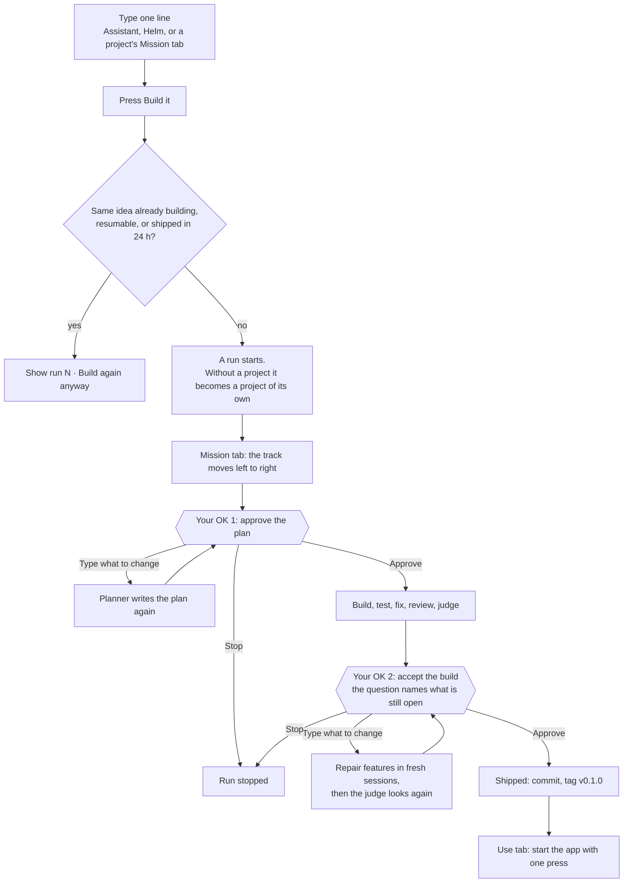

## 3. Inside the engine

What the app does between the two taps. Each box is a station; each loop has its own goal, observer and stop rule.

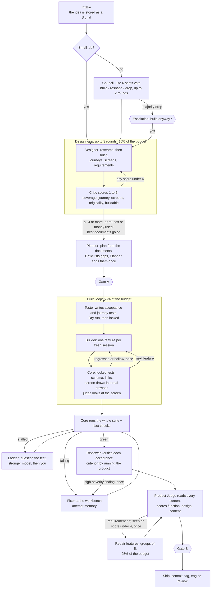

Three things change the route:

- **Practice crew, or a run under $3** (a ticket at $0.60, for example): the Builder writes the app in one call instead of feature by feature, and the judge's findings go to one fix round instead of repair features.
- **The next version of a shipped app** skips the design loop: it keeps its product design (flow 8).
- **No browser on the computer**: the screen check and the judge are skipped and say so. They are never counted as a pass.

## 4. Where the engine stops for you

Only these. Each shows on *Needs you*, in the sidebar badge, in the Assistant and on the project's Mission tab.

| Stop | When | Your choices |
|---|---|---|
| **Gate A** | The plan is written | Approve · type what to change (it is planned again) · Stop |
| **Gate B** | Built, tested, reviewed, judged | Approve (ships) · type what to change (repaired, judged again) · Stop |
| **Council says drop** | A majority of seats voted drop | Build anyway · stop |
| **A station failed** | An agent call or a check failed | Retry (with an optional hint) · Stop |
| **Fix loop stalled** | The ladder is used up: test questioned, stronger model tried | 2 more fix rounds · stop |
| **Budget spent** | The run's cap is reached | Add more (never automatic) · stop |
| **Time limit** | The wall clock for the run is over (30 minutes for a run up to $2, more in proportion to the budget, 4 hours at most; time waiting for you does not count) | The run stops and says what was tried |

Runs started with `autoApprove` (headless runs, and tickets the crew picks up by itself) approve gates A and B on their own. A budget escalation still stops them.

## 5. A note becomes order

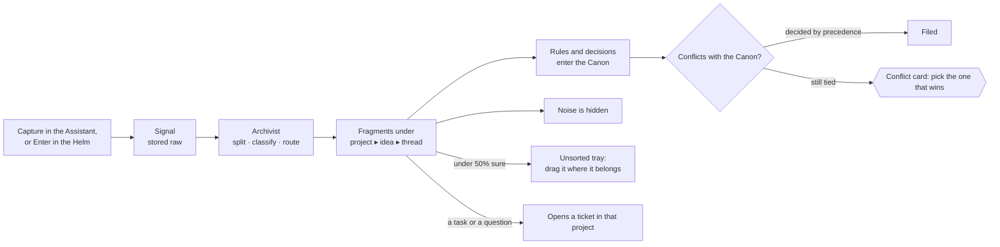

Said in a project's chat, a note is filed under that project unless its words point elsewhere. A daily sweep fades stale notes, raises old questions and proposes merges, all in one briefing with undo. The Archivist is a cheap agent with a daily cap; free heuristics take over on the practice crew, when the cap is spent, or when its answer is unusable.

## 6. A ticket becomes a pull request

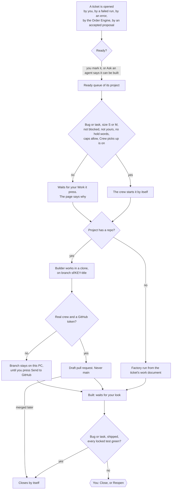

SoftwareFactory's own project is linked to its own GitHub repository, so SF tickets come back as draft pull requests on SF. Caps: $0.60 a ticket, $3 a day, 2 at once per project. See [tickets.md](tickets.md).

## 7. Using a finished app

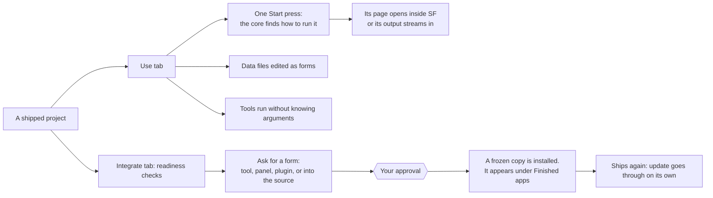

Apps the core starts are stopped when the project is archived, when you press Stop, and when SF closes. See [run.md](run.md) and [integrations.md](integrations.md).

## 8. The next version of a shipped app

On the Mission tab of a project that already shipped, the box reads *Add to this app*. The run works on top of the shipped folder: same data, same locked tests, new tests added. It skips the design loop (the app keeps its design), plans what the ask adds, builds, and ships a new tag. A project that shipped as a script can be turned into an app the same way (*Add a screen*, [screens.md](screens.md)). Tick *as a new app* to start fresh instead.

## 9. Import a repository

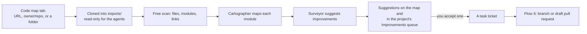

One import has a money cap (`SF_IMPORT_MAX_USD`). The original repository is never written to.

A repository imported for the first time is then reviewed by itself ([review.md](review.md)):

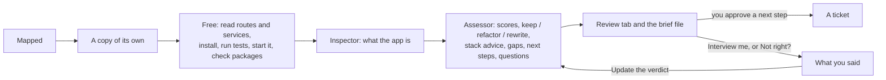

## 10. Stop, crash and resume

A run has no state outside the event log.

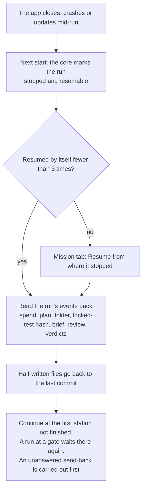

## 11. Updates

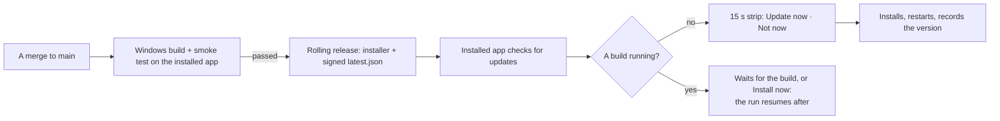

Each build is version `0.2.<CI run number>`. See [updates.md](updates.md).

## 12. An engine cycle

How the engine itself is improved. This is a working method, partly inside the app.

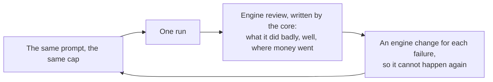

The review and the comparison are built. Turning a "did badly" line into an engine change is done by people and threads today; doing it inside SF is **Planned**.
