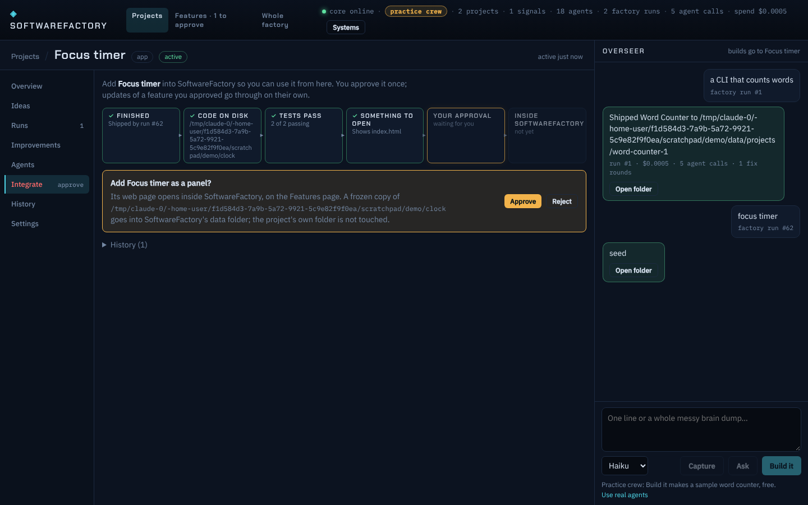
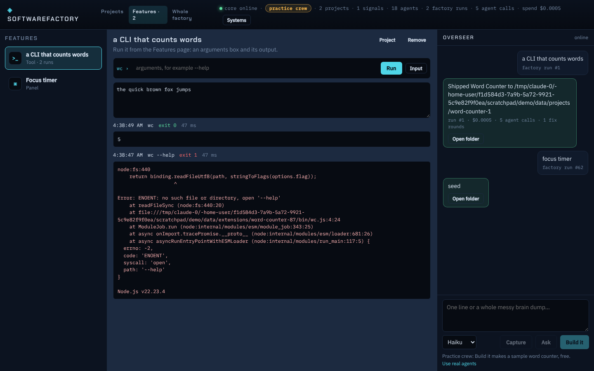
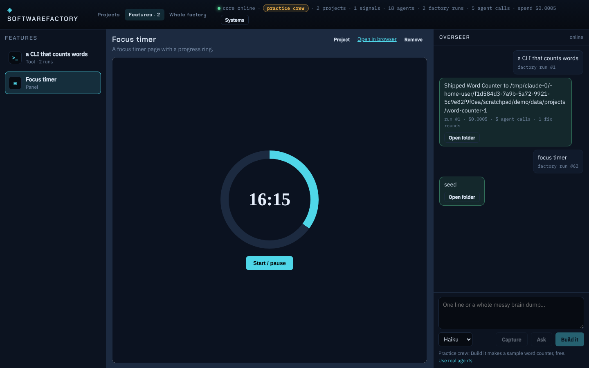

# Adding finished projects into SoftwareFactory

A project the factory finished (or a repo you imported) can be added into SoftwareFactory itself, so you use it from the app instead of a command line in the right folder.

## Three forms

| Form | When | What you get |
|---|---|---|
| **Tool** | the project is a command-line program (package.json `bin`/`main`, a `node x.js` start script, or one script in `bin/`) | the Features page gives it an arguments box, an optional input box, and its output |
| **Panel** | the project has a web page (`index.html` in the root, `dist`, `build`, `public` or `web`) | the page opens inside SoftwareFactory on the Features page (and in a browser tab if you like) |
| **Into the source** | it should become part of SoftwareFactory's own code | a brief for a pull request to SoftwareFactory, ready to paste to Claude; never straight to main |

A project can say what it wants with `softwarefactory.json` in its root:

```json
{ "form": "panel", "title": "Inside runner", "web": "dist", "summary": "Local CI runners at a glance" }
```

## The flow

1. **Integrate** tab of the project: a strip of readiness checks (finished, code on disk, tests pass, same as shipped, dependencies, something to open), then the forms it can take, the suggested one marked.
2. **Ask**: one request per project and form.
3. **Your approval**: the only human step. Approve or reject on the tab (or from the Features page's "Approve …" link). The top bar's Features link shows how many wait for you.
4. **Installed**: a frozen copy of the project's folder (without `.git`) goes to `<data>/extensions/<slug>-<id>/`. The project's own folder is never touched, and later work on it never breaks the installed feature.
5. **Update**: when the project ships again, the tab offers "Update to the newest version". An update of a feature you already approved, same project and form, goes through on its own (decided by `auto`) and replaces the old copy.
6. **Remove**: on the Features page; deletes the copy, keeps the project.

Installed features load from the data folder at runtime, so they need no new SoftwareFactory release or reinstall.





## Safety

- A tool runs with the bundled Node.js, in its installed copy, with a scrubbed environment (no keys or tokens), a 60 second limit and capped output.
- A panel's files are served at `/ext/:id/` from its web folder only; paths that try to leave it get a 404.

## Storage

Projection `integrations` (`packages/core/src/integrations/tables.ts`), one row per request, folded from these events:

```
integration.requested { projectId, form, title, slug, summary, sourceDir, sourceKind, sourceRef, sha, entry, checks, by }
integration.decided   { id, approve, note?, by }
integration.installed { id, dir, files, bytes, head }
integration.briefed   { id, brief }
integration.failed    { id, error }
integration.removed   { id, by }
integration.used      { id, ok, exitCode, ms, args }
```

The request is also linked to its project (`project.linked { kind: "integration" }`), and every project's detail carries `facets.integration`.

## API

```
GET  /api/integrations                     every request and the installed features
GET  /api/integrations/assess/:projectId   readiness checks, forms, suggestion, history
POST /api/integrations                     { projectId, form }
GET  /api/integrations/:id
POST /api/integrations/:id/decide          { approve, note? }
POST /api/integrations/:id/remove
POST /api/integrations/:id/run             { args?, stdin? }   an installed tool
GET  /ext/:id/<path>                       an installed panel's files
```
