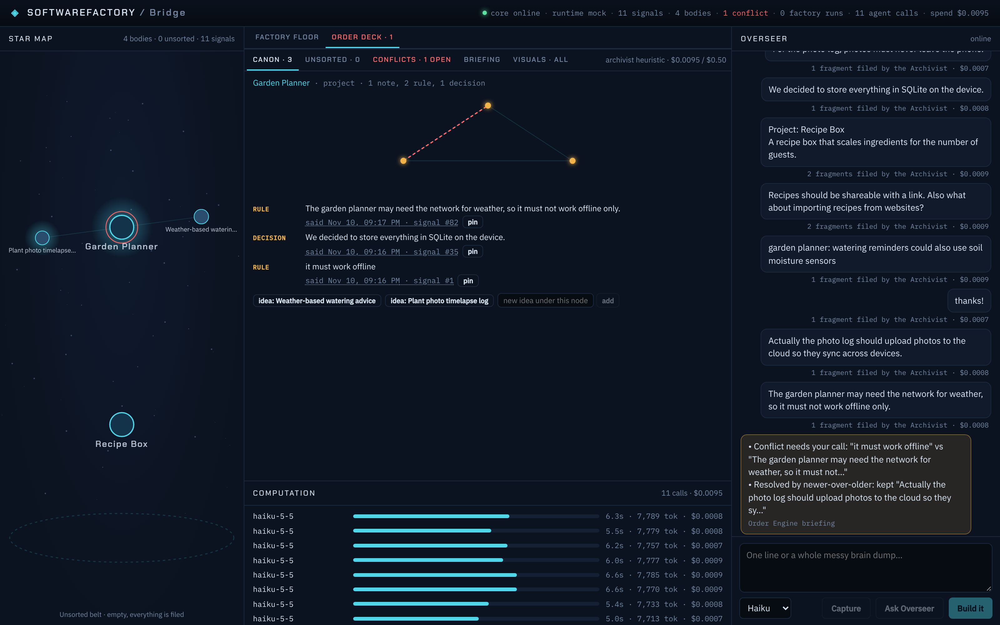
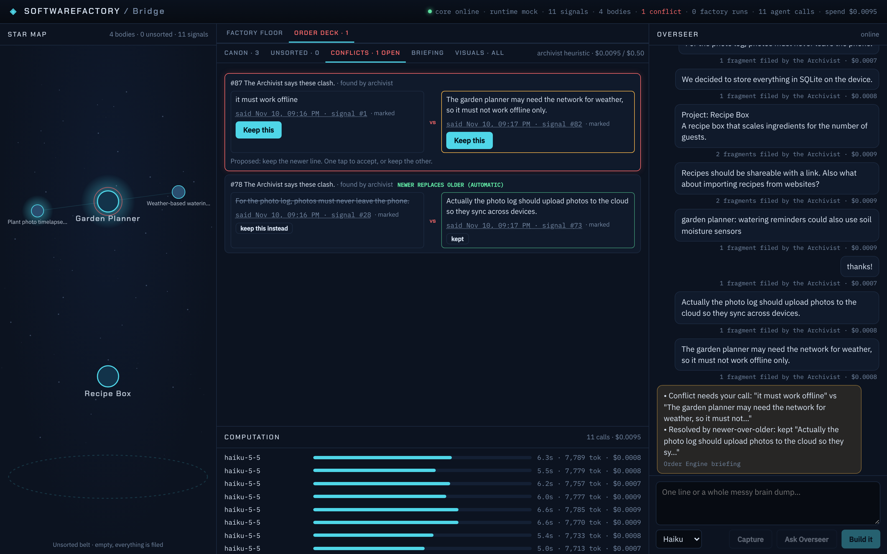

# Milestone 3: the Order Engine, first real runs (2026-11-10)

The milestone's bar from the plan: paste this project's real chat history, agree with most placements, every rule you stated appears in the right Canon with a link to where you said it, and a planted conflict is caught.

## Run 1: this project's real chat (agent Archivist, Haiku)

Input: the 11 messages Assaf wrote in the SoftwareFactory project chat (the project brief, "plan first", the Order Engine requirement, the plugins questions, the stack decision, "everything is visualized", the git rule, the laptop and executable questions), plus one planted line that reverses a core rule:

> Change of plan: every station in the loop needs a human approval tap before it runs.

| | |
| --- | --- |
| Signals | 12 |
| Fragments | 33 (1 hidden as noise: "and stuff like that") |
| Nodes | the SoftwareFactory project plus 4 ideas the Archivist opened: order for messy parallel ideas, visualize everything, agent management, executable build |
| Unsorted tray | 0 |
| Canon | every rule and decision Assaf stated, each linked to the Signal it was cut from |
| Planted conflict | **caught.** "There should be a human approving stations (minimal as possible)" vs the planted line. Both are marked rules on the project itself, so the engine did not pick a winner on its own: it opened a conflict card with a proposal and put it in the briefing. |
| visualizeEverything | 13 of 13 checks pass |
| Cost | **$0.0138** for 12 Haiku calls (about $0.001 each), 104 s |

The raw messages and the full placement report stay in the project's private files, not in this public repo. Whether the placements are right is Assaf's call; the report lists every fragment with its node and confidence so it can be checked line by line.

The free heuristic Archivist, on the same input, filed 20 of 28 fragments under the project, left 8 in the Unsorted tray, and **missed** the planted conflict: it is a clash of meaning (minimal approvals vs approval at every station), which word rules cannot see. That is the job the Haiku Archivist is paid a tenth of a cent for.

## Run 2: a made-up messy chat (in the repo)

[`examples/order/messy-chat.json`](../examples/order/messy-chat.json): two projects started in parallel, chit-chat, a side idea, and two planted reversals. Result: [`examples/order/agent-run.md`](../examples/order/agent-run.md), $0.0095.

- "photos must never leave the phone" then "Actually the photo log should upload photos to the cloud": both your words, same idea node, so **newer replaces older** automatically. The old rule is kept, struck through, with a link to its replacement.
- "Important: it must work offline" then "it must not work offline only": a marked rule on the project itself, so **a conflict card asks** with a proposed answer and one tap to accept.
- "ok", "thanks!": hidden as noise, kept in the raw log.

## How the money is capped

- Each Archivist call is capped at $0.03 (`--max-budget-usd`), lean profile, no tools, no plugins, Haiku.
- The Archivist has a daily cap ($0.50 by default, `SF_ORDER_MAX_USD`). Past it, Signals are filed by the free heuristics and the Overseer feed says so. Nothing stops.
- The prompt carries only the node tree and the 25 nearest Canon rules, not the history, so the cost per Signal stays flat as the project grows (about 7.8k context tokens per call here).

Total spent on model calls for this milestone, including the two re-runs while tuning: about $0.04.
