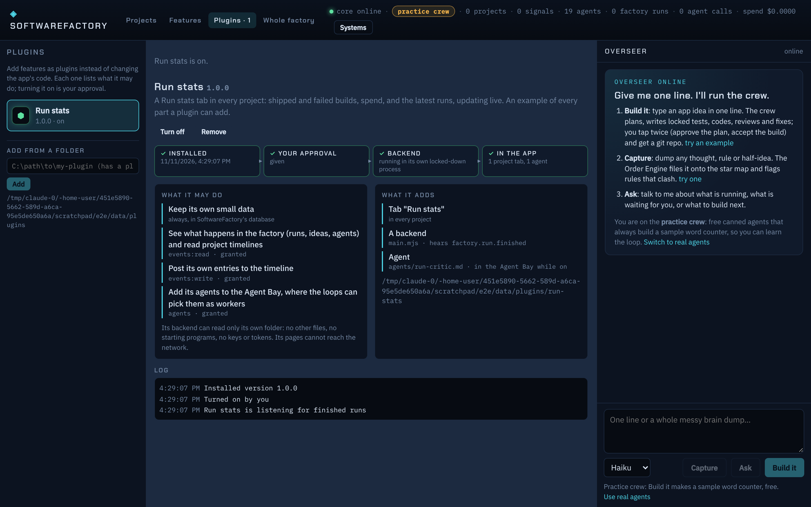
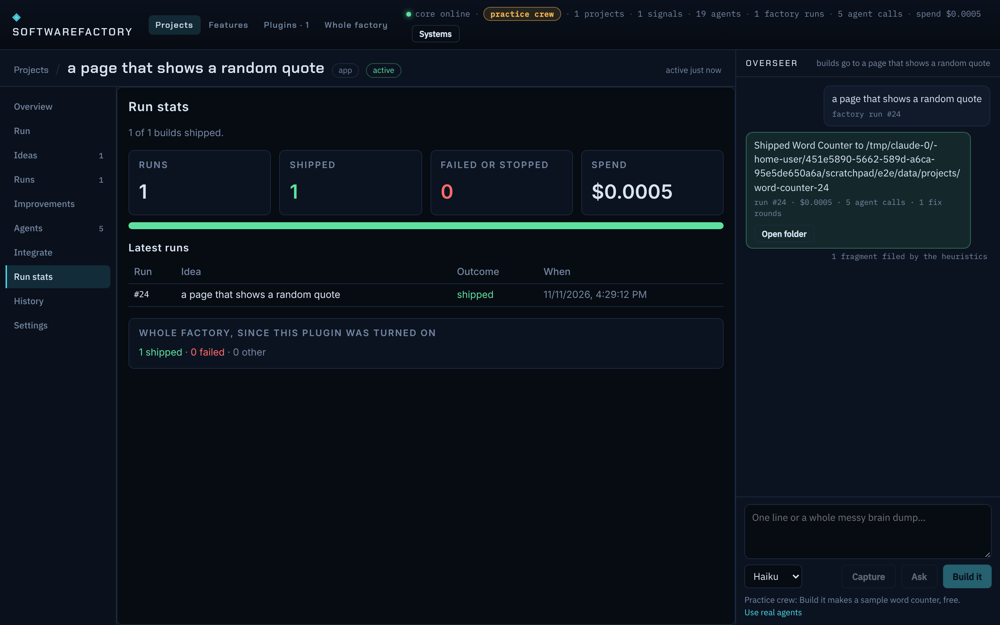

# Plugins

A plugin adds a feature to SoftwareFactory without changing the app's own code. It is a folder with a `plugin.json`. Plugins load from the data folder while the app runs, so adding one needs no new release or reinstall.




## What a plugin can add

| Part | What it is | Manifest |
|---|---|---|
| **Tabs** | a web page shown as a tab in every project (`where: "project"`) or as a page on the Plugins screen (`where: "page"`) | `panels` |
| **A backend** | a script that hears factory events, keeps its own data, answers its pages, posts timeline entries | `main`, `subscribe` |
| **Agents** | agent files (the Agent Bay format) that join the Bay as workers while the plugin is on | `agents` |

```json
{
  "id": "run-stats",
  "name": "Run stats",
  "version": "1.0.0",
  "description": "Shipped and failed builds, spend, and the latest runs, per project",
  "permissions": ["events:read", "events:write", "agents"],
  "main": "main.mjs",
  "subscribe": ["factory.run.finished"],
  "panels": [{ "id": "stats", "title": "Run stats", "entry": "ui/index.html", "where": "project", "order": 85 }],
  "agents": ["agents/run-critic.md"]
}
```

The full example is in `packages/core/plugin-examples/run-stats/` and ships with the app (Plugins page → Examples → Add).

## Permissions

| Permission | Lets it |
|---|---|
| (always) | keep its own small data (key → JSON, 64 KB a value) and write its log |
| `events:read` | hear the events it subscribes to, and read the events of a project (or the whole factory, on a page) |
| `events:write` | post its own timeline entries (`plugin.emitted`) |
| `agents` | add its agents to the Agent Bay (ids prefixed with the plugin id; retired when it is off) |

Turning a plugin on is the one approval: the Plugins page shows what it may do right above the button. A reinstall that asks for nothing new stays on; one that asks for more waits until you turn it on again.

## The backend

Runs in its own Node process (the bundled Node.js), started with Node's permission model:

```
node --permission --allow-fs-read=<plugin folder> --allow-fs-read=<runner> runner.mjs <main>
```

So it can read its own folder and nothing else, cannot write files, cannot start programs, and gets no keys or tokens in its environment (memory capped at 128 MB). It sees the core through a global `sf`:

```js
sf.on("factory.run.*", (e) => { … });           // events it subscribed to
sf.handle("totals", (args) => sf.data.get("totals"));   // its pages call this
sf.data.set("totals", { shipped: 3 });          // kept in SoftwareFactory's database
sf.emit("milestone", { text: "…" }, { projectId });     // a timeline entry (events:write)
console.log("…");                               // its log on the Plugins page
```

If it crashes three times, the host turns it off and says why on the Plugins page. Turning it on again starts afresh. Rate limits: 300 data writes, 60 timeline entries and 200 log lines a minute.

## Pages

Served at `/plugins/<id>/<path>` (only while the plugin is on; the backend's own file is never served) and shown in a sandboxed frame (`allow-scripts allow-forms`, no same origin). Pages cannot call the core themselves (the core refuses API calls from origin `null`, and the page's CSP blocks `connect-src`); they ask the Bridge through a small helper, and the core checks the permission again:

```html
<link rel="stylesheet" href="/plugins/_sdk/sf.css">   <!-- the app's look -->
<script src="/plugins/_sdk/sf.js"></script>
<script>
  sf.projectId;                         // the project this tab is in (null on a page)
  await sf.context();                   // { plugin, project }
  await sf.events({ types: ["factory.run.*"], limit: 500 });  // events:read
  sf.onEvent((e) => …);                 // new events as they happen (this project's only, in a tab)
  await sf.call("totals", {});          // its backend
  await sf.data();                      // its stored data
</script>
```

## From the factory: the Integrate tab

A finished project with a `plugin.json` in its root gets a **Plugin** form on its Integrate tab (suggested first). Approving it there installs the plugin and turns it on in one step; the option's line lists what it may do. An update of a plugin you already approved goes through on its own, but never grants new permissions: if it asks for more, it stays off until you turn it on. Removing the feature removes the plugin.

So the loop for a new feature can be: ask the factory to build a plugin → it ships with tests → Integrate → Approve → it is in the app.

## Storage

Projection `plugins` (`packages/core/src/plugins/tables.ts`): tables `plugins` and `plugin_data`, folded from

```
plugin.installed { id, name, version, dir, manifest, from, by }
plugin.enabled   { id, permissions, by }
plugin.disabled  { id, reason, by }
plugin.failed    { id, error }
plugin.removed   { id, by }
plugin.data      { id, key, value }
plugin.log       { id, level, text }
plugin.emitted   { id, name, payload, projectId? }
```

Installed copies live in `<data>/plugins/<id>/`.

## API

```
GET  /api/plugins                    installed, bundled examples, the folder, permission texts
POST /api/plugins/install            { dir } | { example }
GET  /api/plugins/:id
POST /api/plugins/:id/enable | disable | remove
GET  /api/plugins/:id/log | data
GET  /api/plugins/:id/events?projectId=&types=a,b&limit=
POST /api/plugins/:id/call           { method, args }
GET  /plugins/:id/<path>             an enabled plugin's page files
GET  /plugins/_sdk/sf.js | sf.css
```

## Not yet

- Page network access and a backend network switch: Node 22's permission model does not limit the network, so a backend can still make web requests. Pages cannot.
- Plugins calling agents directly (with a spend cap) and adding factory stations of their own.
- A shared plugin catalog; for now a plugin comes from a folder, an example, or a finished project.
