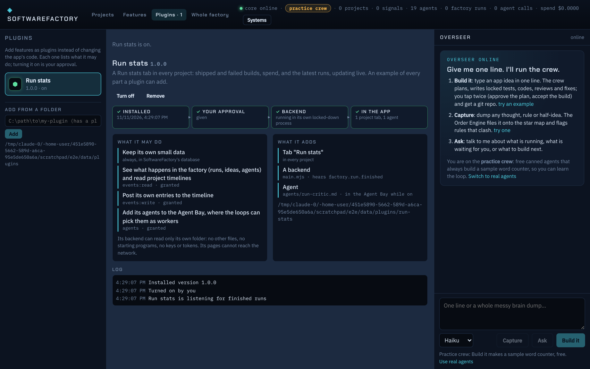
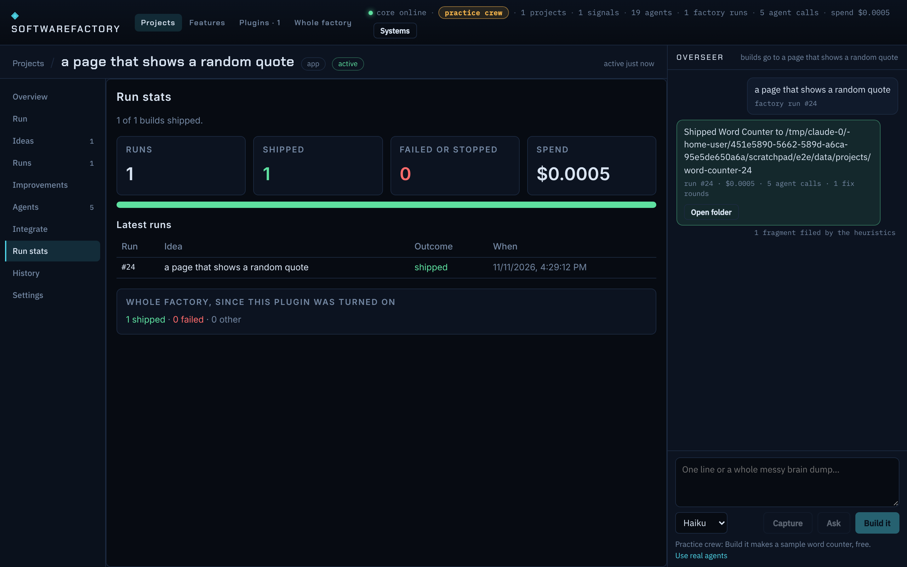

# Plugins

A plugin adds a feature to SoftwareFactory without changing the app's own code. It is a folder with a `plugin.json`. Plugins load from the data folder while the app runs, so adding one needs no new release or reinstall.




## What a plugin can add

| Part | What it is | Manifest |
|---|---|---|
| **Tabs** | a web page shown as a tab in every project (`where: "project"`), as a page on the Plugins screen (`where: "page"`), or as its own item in the main menu (`where: "nav"`, under Add-ons, route `#/a/<id>/<panel>`) | `panels` |
| **A backend** | a script that hears factory events, keeps its own data, answers its pages, posts timeline entries | `main`, `subscribe` |
| **Agents** | agent files (the Agent Bay format) that join the Bay as workers while the plugin is on | `agents` |

```json
{
  "id": "run-stats",
  "name": "Run stats",
  "version": "1.0.0",
  "description": "Shipped and failed builds, spend, and the latest runs, per project",
  "permissions": ["events:read", "events:write", "agents"],
  "main": "main.mjs",
  "subscribe": ["factory.run.finished"],
  "panels": [{ "id": "stats", "title": "Run stats", "entry": "ui/index.html", "where": "project", "order": 85 }],
  "agents": ["agents/run-critic.md"]
}
```

The full example is in `packages/core/plugin-examples/run-stats/` and ships with the app (Plugins page → Examples → Add).

## Permissions

| Permission | Lets it |
|---|---|
| (always) | keep its own small data (key → JSON, 64 KB a value) and write its log |
| `events:read` | hear the events it subscribes to, and read the events of a project (or the whole factory, on a page) |
| `events:write` | post its own timeline entries (`plugin.emitted`) |
| `agents` | add its agents to the Agent Bay (ids prefixed with the plugin id; retired when it is off) |
| `records:read` | read your real projects, tickets and agents: names, states, counts and spend, never file contents |
| `actions` | do the things its manifest lists under `"actions"`, and nothing else |
| `store` | keep its own searchable catalog in SoftwareFactory's database (full-text search, up to 200,000 documents of 256 KB) |
| `video` | watch YouTube links with Gemini, within your key and daily video limit, and search the video notes SoftwareFactory keeps ([videos.md](videos.md)); never files |
| `ai` | ask Claude (it may search and read the web, nothing else), paid from its own monthly budget, which you set |

### Actions: a plugin that does real work

With `actions`, a plugin's page can do real things in SoftwareFactory. This is what a second way into the app (the game door, [game-door.md](game-door.md)) is built on.

```json
{ "permissions": ["records:read", "actions"], "actions": ["ticket.open", "ticket.note"] }
```

| Action | What it does | Arguments |
|---|---|---|
| `project.create` | creates a project | `name`, `kind?`, `summary?` |
| `ticket.open` | opens a ticket | `title`, `kind?` (bug, task, request, idea, question), `body?`, `project?` |
| `ticket.note` | adds a note to a ticket | `id`, `text` |
| `ticket.ask` | marks a ticket the plugin opened as work you asked for: the crew starts it by itself within your standing auto-work limit (Tickets → Limits) | `id`, `on?` (false takes the mark off) |

The rules:

- **Named, one by one.** The manifest must list each action. The Plugins page shows every one in plain words above the Turn on button, and turning it on grants exactly those. An update that adds an action waits until you turn it on again.
- **The same commands the screens use.** An action calls the core command the app's own screens call, so a plugin can do nothing the screens cannot.
- **Marked and logged.** What it makes is marked `plugin:<id>` (a ticket's "opened by"), and every try, allowed or refused, is a `plugin.acted` event and a line in the plugin's log.
- **Money only within your limit.** No action starts a build directly. `ticket.ask` only marks a ticket the plugin opened itself as asked for; the crew then starts it under your standing auto-work limit (per run and per day), the same as a ticket you mark yourself. Write "hold" on the ticket to keep it off.
- **At most 60 actions a minute** per plugin.

The example `field-desk` (Plugins page, Examples, Add) is the smallest plugin that reads real records and acts on them.

Turning a plugin on is the one approval: the Plugins page shows what it may do right above the button. A reinstall that asks for nothing new stays on; one that asks for more waits until you turn it on again.

## The backend

Runs in its own Node process (the bundled Node.js), started with Node's permission model:

```
node --permission --allow-fs-read=<plugin folder> --allow-fs-read=<runner> runner.mjs <main>
```

So it can read its own folder and nothing else, cannot write files, cannot start programs, and gets no keys or tokens in its environment (memory capped at 128 MB). It sees the core through a global `sf`:

```js
sf.on("factory.run.*", (e) => { … });           // events it subscribed to
sf.handle("totals", (args) => sf.data.get("totals"));   // its pages call this
sf.data.set("totals", { shipped: 3 });          // kept in SoftwareFactory's database
sf.emit("milestone", { text: "…" }, { projectId });     // a timeline entry (events:write)
console.log("…");                               // its log on the Plugins page
```

If it crashes three times, the host turns it off and says why on the Plugins page. Turning it on again starts afresh. Rate limits: 300 data writes, 60 timeline entries and 200 log lines a minute.

### Add-ons: a catalog and Claude of its own

An add-on is a plugin with its own menu item, usually with `store` and `ai`. Scout ([PlonterAsi/Scout](https://github.com/PlonterAsi/Scout)) is the first.

```json
{ "permissions": ["store", "ai"], "budget": { "monthlyUsd": 30 }, "main": "main.mjs",
  "panels": [{ "id": "home", "title": "Scout", "entry": "ui/index.html", "where": "nav", "order": 10 }] }
```

From the backend:

```js
await sf.store.put("finds", id, doc, "text to search");      // store
await sf.store.query({ coll: "finds", text: "mcp postgres", where: { verdict: "use" }, sort: "-score", limit: 50 });
// → { items: [{ id, doc, updatedAt, rank, snippet }], total }
await sf.store.get("finds", id); await sf.store.delete("finds", id); await sf.store.count("finds");

await sf.ai.run({ prompt, system, model: "haiku", tools: ["WebSearch", "WebFetch"], budgetUsd: 0.4, practice: "[]" });  // ai
// → { text, costUsd, practice }   refused when it would pass the month's budget
await sf.ai.budget();   // { monthlyUsd, spentUsd, leftUsd }
await sf.video.watch({ url, question, start, end, fps });   // video: → { id, title, notes, model, cached, … }
await sf.video.search("rust cli", 20); await sf.video.get(id); await sf.video.status();   // { hasKey, today, dailyMax, notes }
// A note on a clip fetched from a dropped link (Instagram, TikTok, X…) carries `link`: the post it came from; `source` is then the saved file.
await sf.act("ticket.open", { … }); await sf.records("projects");   // the same as pages, from the backend
```

The rules for `ai`:

- **Its own budget.** The manifest suggests a monthly cap (`budget.monthlyUsd`, default $5, at most $100); you change it on the Plugins page. A call is refused when what is left this month is less than its own cap, so the month never goes over.
- **One call, one cap.** At most $2 a call (default $0.25), two at a time, 15 minutes each.
- **Web only.** The only tools are WebSearch and WebFetch: Claude reads the web for the add-on and touches nothing on your computer.
- **Practice crew.** When SoftwareFactory runs on the practice crew, no money is spent and the call returns the add-on's own `practice` answer, marked `practice: true`.
- **Logged.** Every call is a run of agent `plugin:<id>`, with its cost, in the factory's spend.

### Install from GitHub

Plugins page → **Add from GitHub** → `owner/repo` (or `owner/repo/folder`, and a branch or tag). SoftwareFactory downloads the repository through its GitHub sign-in (so private repositories work), uses the `plugin/` folder when the root has no `plugin.json`, and installs it turned off. It checks every installed GitHub add-on for a newer version a minute after start and then every 6 hours (also the **Check for update** button); an update that asks for nothing new stays on.

## Pages

Served at `/plugins/<id>/<path>` (only while the plugin is on; the backend's own file is never served) and shown in a sandboxed frame (`allow-scripts allow-forms`, no same origin). Pages cannot call the core themselves (the core refuses API calls from origin `null`, and the page's CSP blocks `connect-src`); they ask the Bridge through a small helper, and the core checks the permission again:

```html
<link rel="stylesheet" href="/plugins/_sdk/sf.css">   <!-- the app's look -->
<script src="/plugins/_sdk/sf.js"></script>
<script>
  sf.projectId;                         // the project this tab is in (null on a page)
  await sf.context();                   // { plugin, project }
  await sf.events({ types: ["factory.run.*"], limit: 500 });  // events:read
  sf.onEvent((e) => …);                 // new events as they happen (this project's only, in a tab)
  await sf.call("totals", {});          // its backend
  await sf.data();                      // its stored data
  await sf.records("tickets");          // real projects | tickets | agents (records:read)
  await sf.act("ticket.open", { title: "…", kind: "task" });  // a listed action (actions); in a project tab it lands in that project
  await sf.open("https://github.com/…");  // opens a web link in your browser (the sandbox cannot open windows)
  await sf.copy("text");                // copies to the clipboard
</script>
```

A page's sandbox blocks `alert`, `confirm` and `prompt`: confirm in the page itself (Scout uses a second click).

## From the factory: the Integrate tab

A finished project with a `plugin.json` in its root gets a **Plugin** form on its Integrate tab (suggested first). Approving it there installs the plugin and turns it on in one step; the option's line lists what it may do. An update of a plugin you already approved goes through on its own, but never grants new permissions: if it asks for more, it stays off until you turn it on. Removing the feature removes the plugin.

So the loop for a new feature can be: ask the factory to build a plugin → it ships with tests → Integrate → Approve → it is in the app.

## Storage

Projection `plugins` (`packages/core/src/plugins/tables.ts`): tables `plugins` and `plugin_data`, folded from

```
plugin.installed { id, name, version, dir, manifest, from, by }
plugin.enabled   { id, permissions, by }
plugin.disabled  { id, reason, by }
plugin.failed    { id, error }
plugin.removed   { id, by }
plugin.data      { id, key, value }
plugin.log       { id, level, text }
plugin.emitted   { id, name, payload, projectId? }
plugin.acted     { id, verb, ok, projectId?, result? | error? }
plugin.budget    { id, monthlyUsd, by }
```

Catalogs (`store`) live in tables `plugin_docs` and `plugin_docs_fts` (FTS5), written directly rather than as events, since a catalog can hold many thousands of documents; removing a plugin clears its catalog.

Installed copies live in `<data>/plugins/<id>/`.

## API

```
GET  /api/plugins                    installed, bundled examples, the folder, permission texts
POST /api/plugins/install            { dir } | { example } | { github: "owner/repo[/folder]", ref? }
POST /api/plugins/:id/update         a newer version from its GitHub repository
GET  /api/plugins/:id/budget         { monthlyUsd, spentUsd, leftUsd }
POST /api/plugins/:id/budget         { monthlyUsd }
POST /api/plugins/:id/open           { url }  a web link, in your browser
GET  /api/plugins/:id
POST /api/plugins/:id/enable | disable | remove
GET  /api/plugins/:id/log | data
GET  /api/plugins/:id/events?projectId=&types=a,b&limit=
POST /api/plugins/:id/call           { method, args }
GET  /api/plugins/:id/records?kind=projects|tickets|agents&projectId=&limit=
POST /api/plugins/:id/act            { verb, args }
GET  /plugins/:id/<path>             an enabled plugin's page files
GET  /plugins/_sdk/sf.js | sf.css
```

## Not yet

- Page network access and a backend network switch: Node 22's permission model does not limit the network, so a backend can still make web requests. Pages cannot.
- Actions that spend money (work a ticket, start a build), each with its price and a hold to confirm, and the Sector game reading real records and giving orders from its map.
- Plugins starting full agents (with files and tools) and adding factory stations of their own; for now `ai` is Claude with the web only.
- A sandbox for trying a find (a throwaway Linux box with no access to your drives or keys).
- A shared plugin catalog; for now a plugin comes from a folder, an example, GitHub, or a finished project.
