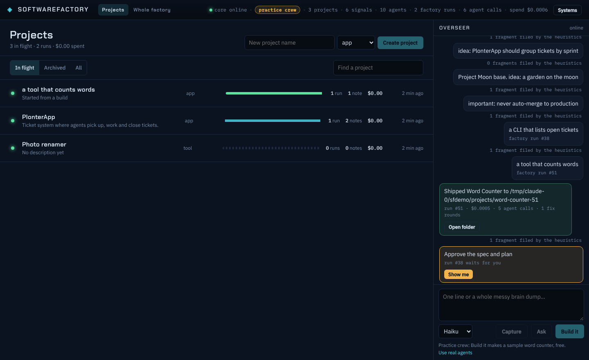
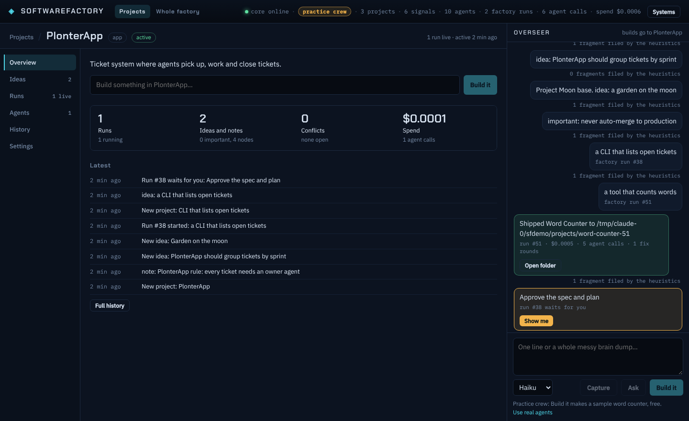

# Projects

SoftwareFactory is organized around **projects**. A project is the thing you work on: an app, a tool, a library, research. Everything else belongs to one project: its ideas and rules in the Order Engine, its factory runs, the agent calls those runs made, the files they wrote, and whatever later parts of the app add (tickets, improvement proposals).

## Model

| Table | One row per |
|---|---|
| `projects` | project: name, kind (`app`, `tool`, `library`, `research`, `general`, or your own), status (`active`, `paused`, `shipped`, `archived`), summary, origin, times |
| `project_links` | thing that belongs to a project: `(kind, ref)` → `project_id`. One owner per thing. |

Both are a projection (`packages/core/src/projects/`), folded from the event log like every other table, so they rebuild from the log at any time.

**Ids.** A project's id is an event id (an integer):
- made by you (Bridge or `POST /api/projects`): the `project.created` event's id;
- adopted from an Order Engine root node: that node's id;
- adopted from a factory run started without a project: the run's id.

Never assume a project id equals a node id; ask `projectOf(log, { kind, ref })` or `GET /api/projects/of?kind=&ref=`.

**Events.**

```
project.created  { name, kind?, summary? }
project.updated  { projectId, name?, kind?, summary?, status? }
project.linked   { projectId, kind, ref }     move a thing into a project
project.unlinked { projectId, kind, ref }
```

**Adoption (no data migration needed).** History from before projects existed is read as it is:
- every live Order Engine root node is a project of its own;
- a factory run started without a project is a project of its own, and the root node its intake Signal grows joins it;
- a run started with `projectId` joins that project, and so does its intake node;
- a root node merged into another by the Order Engine takes its project along;
- an adopted project with nothing left in it disappears; projects you made or renamed stay.

**Links are open.** The core fills `order_node` and `factory_run`. Any other part of the app links its own things with `project.linked { kind: "ticket", ref: "T-7" }`; the project's rollup counts them by kind. The child ideas and threads of a root node belong to the same project through the node tree.

## API

```
GET  /api/projects                    every project with its rollup (runs, shipped, failed, running, agent calls, spend, nodes, fragments, important, open conflicts, linked counts, last activity)
POST /api/projects                    { name, kind?, summary? }   also gives it an Order Engine root node, so ideas can be filed there
GET  /api/projects/of?kind=&ref=      which project owns a thing
GET  /api/projects/:id                links, node tree, runs, agents, files, facets
POST /api/projects/:id                { name?, kind?, summary?, status? }
POST /api/projects/:id/links          { kind, ref }
POST /api/projects/:id/unlink         { kind, ref }
POST /api/projects/:id/runs           { idea, maxUsd?, again? }   start a factory run inside this project
POST /api/projects/:id/merge          { into }   move every link into another project; this one goes away (archived if you made it)
```

`POST /api/factory/runs` also takes `projectId` and `again`.

### One idea, one run

Every Build (`/api/factory/runs`, `/api/projects/:id/runs`, an improvement's Build) first asks `factory.duplicateOf(idea)`: a run of the same idea (case, spacing and the closing period ignored) that is still in flight, stopped and resumable, or shipped in the last 24 hours. If there is one, the answer is `409 { duplicateOf, state, projectId }` and nothing starts; the Bridge shows "Run #N is already building this idea" with **Show run #N** and **Build again anyway** (the same request with `again: true`). A failed or rejected run never blocks a new attempt.

Why: one Overseer "Build:" suggestion was pressed five times on a real PC (2026-11-11). Each press started a full run, three from General became three projects with the same name, and two landed in whatever project chat was open. Now a suggestion that was pressed shows "Building as run #N · Show", builds in the chat it was given in, and the Projects list marks live projects that share a name ("same name as 1 other · merge"), which opens Settings → **Merge into another project**.

## Extension points

- **Core facets**: `registerProjectFacet({ id, compute(log, project, links) })` adds a section to every `GET /api/projects/:id` under `facets[id]`.
- **Integrations**: a finished project can be added into SoftwareFactory as a tool, a panel, or a pull-request brief; see [integrations.md](integrations.md).
- **Bridge panels**: `registerProjectPanel({ id, title, order, render })` in `apps/bridge/src/projects/panels.tsx` adds a tab to every project's workspace. `appliesTo(project)` limits it to some kinds.

## On the Bridge

The Bridge opens on **Projects**: every project, most recently active first, with a hull bar of its runs (green shipped, cyan running, grey stopped, red failed), its notes, open conflicts, linked things and spend. Name a new one at the top, or press **Build it** in the Overseer: a build started outside a project becomes a project of its own.



Opening a project shows its **workspace**: a row of tabs under the header (Improve, Know and add-on tabs under **More**) and the chosen tab at full width. Built in: **Mission** (the latest build as a track of stops, see [design.md](design.md#mission-the-project-page)), **Product** (the latest product design), **Run** (start the finished project from its folder, see its output and its pages; see [run.md](run.md)), **Ideas** (the project's own star map and Order deck), **Runs** (the factory floor with only this project's runs), **Agents** (who worked here and what it cost), **History**, **Settings** (name, kind, status, folders). While a project is open, the Overseer's Build it starts runs in that project.



## Project chats

The Overseer pane is split into chats: **General** plus one chat per project. Opening a project opens its chat; the tabs at the top of the pane switch by hand, and "Other chats…" opens any other project's chat.

- **A project's chat** shows only that project: what you said there, notes from General that the Order Engine filed into it (marked "from General"), the Overseer's answers to questions asked there, its builds, and its gates. Words said there are filed under the project (the Archivist is told where they were said, and heuristics send words with no clearer home there instead of to Unsorted). A new topic opened from a project's chat becomes an idea in that project, never a stray project of its own. Asking there gives the Overseer that project's name, summary and latest runs first. Build it starts runs in that project.
- **General** is for cross-project talk and anything not yet tied to a project, plus the Order Engine's daily briefing and each project's headlines only: what shipped, what failed, and what waits for you, each tagged with its project.

Nothing new is stored. A Signal carries `projectId` when said in a project's chat, an Overseer call carries `projectId` in `agent.run.started`, and everything else is read from `project_links` and the Order Engine's fragments (`packages/core/src/chat/routes.ts`):

```
POST /api/signals     { text, projectId? }            404 when that project is gone
POST /api/agent/run   { prompt, model?, projectId? }
GET  /api/chat/routes                                  { filed: { signalId: [projectId] }, factoryRuns: { runId: projectId } }
```

**Whole factory** in the top bar is the cross-project view from before (star map, factory floor, Agent Bay, Order deck, Data vault).

Addresses: `#/` projects, `#/p/12/runs/57` project 12's Runs panel showing run 57, `#/factory/bay` the Agent Bay. The old `#order`, `#bay`, `#data` still work.
