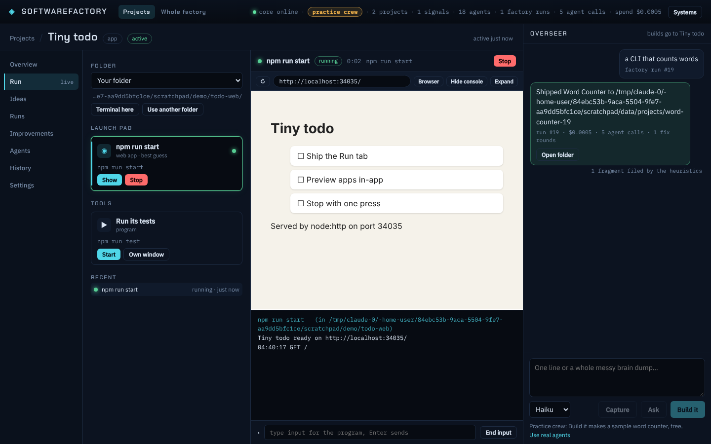

# Running projects from the app

A finished project should not need a command line. Every project has a **Run** tab (right after Overview) that starts it from its own folder and shows it.

## What it finds



The core looks at the project folder (`packages/core/src/launch/detect.ts`) and lists the ways to run it, the best guess first:

| Kind | Found from | What you get |
|---|---|---|
| web app | a package.json script that starts a dev server (vite, next, http-server, ...) or runs a file that calls `createServer`/`listen`; Flask, FastAPI, Streamlit, Django | it gets a free `PORT`; the first local address it prints opens in a **preview frame** inside the app |
| pages | an `index.html` in the folder or in `dist/`, `build/`, `public/`, `docs/`, ... | the core serves the folder at `/preview/:projectId/` and shows it in the frame; nothing to start |
| command-line tool | `bin` in package.json, or `bin/*.js` (what the factory writes) | an arguments box; output in a live console; typed input goes to the program, **End input** closes it |
| program | other scripts, `main`, `main.py`, `cargo run`, `go run .`, `start.bat` | live console |
| tools | `test`, `build`, and **Install packages** when dependencies are missing | listed apart |

Node projects run on the Node.js the app ships with, with the project's `node_modules/.bin` and that Node first on `PATH`, so a script like `node server.js` works without installing anything. Only Install packages needs npm.

**Own window** runs it in a console window of its own instead (a big program, or one that needs a real terminal); the app does not watch that one. **Terminal here** opens a terminal in the folder.

## Which folder

`projectFolders(log, projectId)`: a folder you added (**Use another folder**, link kind `folder`), then the imported repo, then the newest shipped factory build, then other builds. Pick another from the Folder list.

## Safety

- The program's environment is yours minus anything that looks like a secret (`*TOKEN*`, `*SECRET*`, `*API_KEY*`, `*PASSWORD*`, ...) and the core's own `SF_*` settings.
- Stop ends the whole process tree (`taskkill /T` on Windows, the process group elsewhere); closing the app stops everything it started.
- The preview server refuses paths outside the folder and the `.git` folder. `/api/launch/open` only opens local addresses.

## Data

Events `launch.started`, `launch.url`, `launch.stopped`, `launch.exited` (with the last 60 output lines). Projection `launch` → table `launch_sessions`. Live output stays in memory while the core runs (last 3,000 lines per session). Sessions still open when the core starts again are closed as `app-closed`.

## API

```
GET  /api/launch/projects/:id?dir=        folders, profiles found in one, running and recent sessions
POST /api/launch/projects/:id/start       { profileId?, args?, dir?, mode?: "inline" | "window" }   no profileId = the best guess
POST /api/launch/projects/:id/folder      { dir } add a folder of yours; { dir, remove: true } forget it
POST /api/launch/projects/:id/terminal    { dir? }
GET  /api/launch/sessions/:sid?after=n    session and output lines after n
GET  /api/launch/sessions/:sid/stream     server-sent events: `state`, `line`
POST /api/launch/sessions/:sid/stop
POST /api/launch/sessions/:sid/input      { text } or { end: true }
POST /api/launch/open                     { url } a local address, in your browser
GET  /preview/:id/...                     plain pages, while that project's preview is on
```

Other parts of the core can reuse `detectProfiles(dir)`, `Launcher` and `serveStatic(res, root, path)`.
