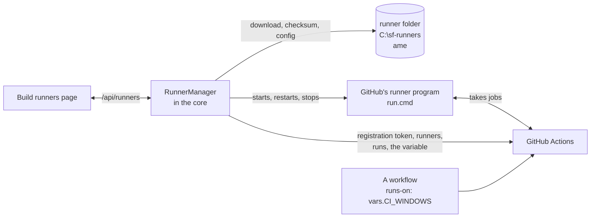

# Build runners

SoftwareFactory's own manager for GitHub Actions runners on your PC. With it, a repository's checks and builds run on your PC, free, instead of on GitHub's machines. It is part of the app: the page **Build runners** in the sidebar (`#/runners`), the module `packages/core/src/runners/`.

Why it exists: a private repository gets 2,000 free minutes a month on GitHub's machines, and SoftwareFactory's own Windows build used about 1,200 in one day. A runner on your own PC costs nothing.

## What it does



| You press | What happens |
|---|---|
| **Add a runner** | You give a repository. The name, labels and folder are filled in. SF downloads GitHub's runner program, checks it against the checksum GitHub publishes, asks GitHub for a one-time registration token with your sign-in on this PC, registers the runner, and starts it. Nothing to copy or paste. |
| **Start**, **Stop**, **Restart** | Stop ends the runner and everything it started, and it stays off. If a job is running, SF asks first: stopping cuts the job off and GitHub shows it as failed. |
| **Send builds to this PC** | Sets the repository variable `CI_WINDOWS` to this runner's labels (and `CI_SMOKE`, when this PC has Windows Sandbox). Workflows that read it land here. On a public repository SF also tells GitHub to hold every outside contributor's workflow for your approval. |
| **Send builds back to GitHub** | Deletes the variables. The same workflows run on GitHub's machines again. |
| **Remove** | Stops it, takes its registration off GitHub, forgets it. Its folder stays on disk. |

The page also shows, per runner: its state, the job it is running, the runs waiting and done on GitHub **with the machine each job ran on** (this PC or GitHub's), the jobs this runner took, and its live log.

## Rules it keeps

- **SF closes what it starts.** Every runner is a child of the core and ends with it. A runner left behind by a core that was killed is ended at the next start, before a new one starts.
- **A runner that ends by itself starts again**: after 5 s, doubling up to 5 min; back to 5 s once it has run 10 min.
- **Tokens are never written down.** The GitHub sign-in is the GitHub CLI's on this PC (`gh auth token`), else the token pasted in Systems. It and the one-time registration token are held in memory only and are masked in the log.
- **A runner gets no secrets**: its environment is yours without anything that looks like a key or token and without SF's own settings. Git's bash and Rust's tools are put first on its PATH, so a job's `shell: bash` never lands in WSL.
- **The app does not update itself over a job.** An update that installs by itself waits while a runner here is running a job.
- **The PC stays awake during a job**, and may sleep again when it ends.
- **Runners belong to the app, not to a base.** Switching bases does not stop them.

## A workflow that can run here

```yaml
jobs:
  build:
    # Your own PC when the variable is set; GitHub's machine when it is not, and for pull requests from forks.
    runs-on: ${{ (github.event_name != 'pull_request' || github.event.pull_request.head.repo.full_name == github.repository) && fromJSON(vars.CI_WINDOWS || '"windows-latest"') || 'windows-latest' }}
```

The PC needs what the job needs. For SoftwareFactory's own build: Visual Studio's C++ build tools, Rust (rustup), Git. Node.js and the Rust cache come from the workflow's own steps.

## A public repository

A pull request can carry its own workflow file, so on a public repository a stranger could ask for your runner. Two guards: the workflow sends fork pull requests to GitHub's machines, and "Send builds to this PC" turns on GitHub's rule that holds outside contributors' workflows until you approve them. A private repository has no outside contributors.

## The smoke test runs in a Windows Sandbox

`scripts/smoke/windows-smoke.mjs` installs and uninstalls the app, moves the data folder aside and uses the app's own port. Run in your own Windows account it would break your installed SoftwareFactory. So on a runner of your own the workflow runs `scripts/smoke/sandbox-smoke.mjs` instead:

1. It puts the installers, the scripts and Node.js into one shared folder, and shares Git from the PC read-only.
2. It opens a Windows Sandbox: a clean, throwaway Windows with its own files, registry and ports. A window opens on your desktop; nothing in it needs a click.
3. The sandbox runs the same smoke test at sign-in. Its console comes back live through the shared folder, then its report, logs and screenshots.
4. The sandbox is closed and everything in it is gone. The job ends with the test's own result.

This has its own repository variable, `CI_SMOKE`. "Send builds to this PC" sets it only when Windows Sandbox is turned on (Windows 10/11 Pro, Windows features, Windows Sandbox); otherwise the smoke test stays on GitHub's machines and the page says so. One sandbox runs at a time, and someone must be signed in at the PC.

## Files

In the app's data folder, under `runners/`: `runners.json` (the list), `jobs.json` (the last 200 jobs), `logs/<id>.log` (5 MB, one older copy kept), `cache/` (the downloaded runner program), `<id>.pid`.

## API

Answered by the app itself, before a base's own routes.

| Route | What |
|---|---|
| `GET /api/runners` | The runners, the jobs they took, how many run now |
| `GET /api/runners/suggest?repo=` | A name, labels and folder for a repository's runner |
| `POST /api/runners` | `{ repo, name?, labels?, dir? }` add one and set it up |
| `GET /api/runners/github?repo=` | GitHub's side: its runners, the variable, the latest runs and each job's machine |
| `GET /api/runners/:id/log?after=` | What the runner printed after line n |
| `POST /api/runners/:id/start` \| `stop` \| `restart` \| `setup` | |
| `POST /api/runners/:id/route` | `{ on }` send builds here, or back |
| `POST /api/runners/:id/remove` | |

## Not built yet

- Linux runners inside WSL.
- Keeping the build's `target` folder between runs (each run restores GitHub's cache instead).
- A tray icon and starting with Windows: today builds wait while SoftwareFactory is closed.
