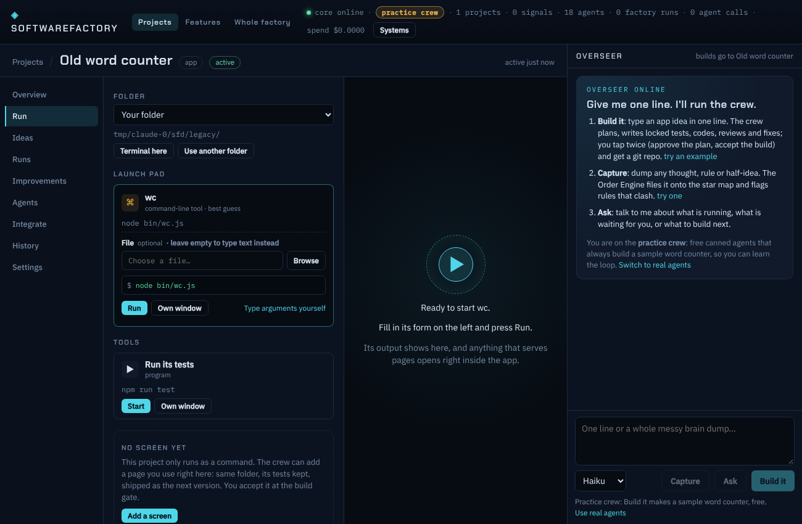

# Every project has a screen

> Superseded by [apps.md](apps.md): every project is now a real program on the app kit (full CRUD, a System view, one-press Start), and "Add a screen" became "Turn into an app". This page describes the earlier page-only default, still used for plans from before.

visualizeEverything applies to what the factory makes, not only to the factory itself. A project the crew finishes opens as a page inside SoftwareFactory (the project's **Run** tab), not as a command you have to type.

## What the crew builds

The station contracts (`packages/core/src/bay/builtin.ts`, `UI_TARGET`) ask every plan and build for:

- `index.html` at the project root, `web/app.js` (an ES module) and `web/style.css`. Plain HTML, CSS and JavaScript, no frameworks, nothing from the internet, no build step.
- The page imports the core from `src/` (`../src/x.js`), so the code the locked tests prove is the code the page runs. Anything the page imports must run in a browser; Node-only code lives in files the page never imports.
- On first open it already shows a sample and its result; every control is wired; results are drawn (tables, bars, previews), errors shown on the page.
- `server.js` only when the idea needs the disk or the OS (it listens on `process.env.PORT`, prints its address, and the page calls its `/api/`). The Run tab then starts it as a web app.
- A CLI (`bin/<name>.js`) only when the idea asks for a command line or scripting, next to the page. It prints `usage: name <input> [--flag]`.

The plan has three new fields: `ui` (the screen), `cli` (the usage line or "") and `examples` (ready-to-run CLI inputs). A plan with no `ui` gets a default one, so nothing skips the screen. SPEC.md gets a **Screen** section. At ship the core writes `run.json` from `examples`, which the Run tab turns into one-press example runs.

The Council's Visionary and Architect now speak about the screen too; the Tester still tests only the `src/` core; the Reviewer treats a blank page or a dead button as a high finding.

## The page check

`checkUi(dir)` (`packages/core/src/factory/uicheck.ts`) runs with the locked tests and is free (no browser, no agent):

- `index.html` exists at the root and has content;
- every local script and stylesheet it names exists, nothing loads from the internet;
- every module the page reaches (transitively) exists, parses, and imports no `node:` module or package;
- a `server.js` listens on `process.env.PORT`;
- ids the scripts look up but the page lacks are listed as notes.

It shows as one more cell in the test grid ("the page loads ...") and a failure goes to the Fixer like a failing test. Event: `factory.ui`. Runs whose plan predates this (no `ui`) are not held to it, so resuming an old run still works.

## Adding a screen to a finished project

`Factory.addScreen(baseRun)`, `POST /api/projects/:id/screen`, the **Add a screen** button on the Run tab when a project has no page:

- works in the project's own folder, on top of what shipped; refuses a folder with uncommitted changes;
- keeps the plan and the locked tests (the floor shows intake, Council, plan and tests as "kept from run #N"), so no Council, Planner or Tester calls and no plan gate;
- the Builder gets the current code and adds the page (moving browser-usable logic out of Node-only modules if needed), then the locked tests and the page check must pass, the Reviewer looks, you accept at the build gate;
- ships as the next version (`v0.2.0` after `v0.1.0`); a run that does not ship puts the folder back at the shipped commit.

Cost: one Builder call plus a Reviewer call and any fix rounds, capped at $1 per run by default.

## Cost of the default

The Builder writes three more small files (the page is asked to stay plain), so its output grows; its per-call cap ($0.60) and the run cap ($1.50) are unchanged and still stop a run that runs over. The page check costs nothing.

