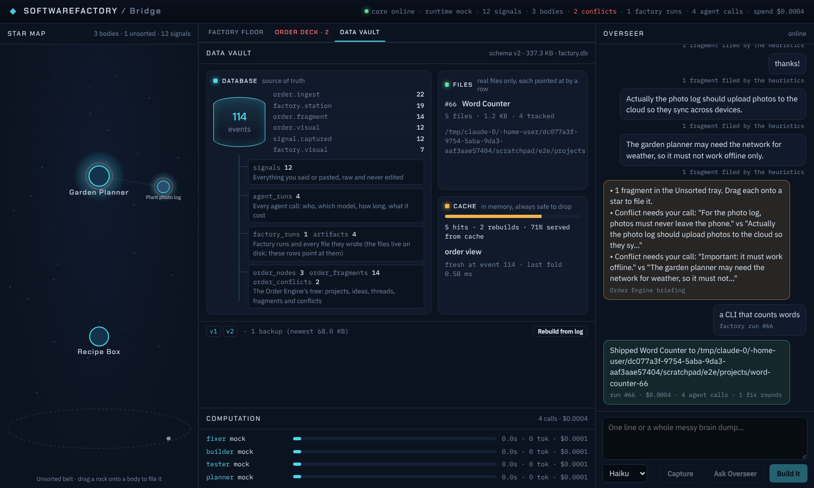

# Storage: database, files, cache

SoftwareFactory keeps its data in three tiers, each with one job. The Bridge's **Data vault** tab draws all three live.



| Tier | Where | Holds | Can it be rebuilt? |
|---|---|---|---|
| **Database** | `factory.db` (SQLite, WAL) in the app data folder | The append-only event log (source of truth) and organized tables derived from it | The log: never touched. The tables: yes, from the log, any time |
| **Files** | `projects/` next to the database | Only things that really are files: the git repos the factory generates | They are the product; every file is pointed at by an `artifacts` row with its size and SHA-256 |
| **Cache** | Core process memory | Folded views (the Order Engine's tree), keyed by the newest event id | Yes, always: drop it and the next read recomputes it |

In the desktop app the data folder is the Tauri app data directory (on Windows `%APPDATA%\dev.plonter.softwarefactory\`); in dev it is `.sf-data/`. `SF_DB` and `SF_PROJECTS` override both.

## The database

**Source of truth: `events`.** Every Signal, agent call, factory step, Order Engine change and store action is one row: id, time, type, JSON payload. Nothing is updated or deleted, which gives history, replay and undo. Full-text search over Signals lives in `signal_fts`.

**Organized tables.** Each is owned by a *projection* (`packages/core/src/store/`), kept current in the same transaction as the event that changes it, so a table is never behind the log:

| Table | One row per | Projection |
|---|---|---|
| `signals` | thing you said or pasted, raw | `signals` |
| `agent_runs` | agent call: agent, model, station, status, cost, time, context tokens, error | `agent_runs` |
| `factory_runs` | factory run: idea, outcome, repo folder, commit, spend, fix rounds | `factory_runs` |
| `artifacts` | file a run wrote: path, station, round, bytes, lines, SHA-256, versions | `factory_runs` |
| `order_nodes`, `order_fragments`, `order_conflicts` | project/idea/thread, filed fragment, conflict | `order` (materialized from the Order Engine's fold) |

Open `factory.db` in any SQLite browser and query them directly, for example spend per agent:

```sql
SELECT agent, count(*) AS calls, round(sum(cost_usd), 4) AS usd FROM agent_runs GROUP BY agent ORDER BY usd DESC;
```

**Schema versions and migrations.** `PRAGMA user_version` holds the schema version; `schema_migrations` records every step with its time. Steps only add. A projection has its own `version`: bump it and its tables are dropped and refilled from the log on the next start. A projection new to an existing database is backfilled the same way. `projections` records each one's version, the last event it has applied, and any error.

**Upgrades never lose data.** Before an existing database is migrated, a full copy is written next to it (`factory.db.v<old>-<time>.bak`, newest 3 kept) and a `store.migrated` event records it. Databases made by milestones 1 to 3 (just `events` and `signal_fts`) are adopted as they are and their tables are backfilled from their history.

**A broken table never loses an event.** If a projection throws, only its own change is rolled back, the event is still stored, the error is recorded and the Data vault shows that table red. **Rebuild from log** (or `POST /api/store/rebuild`) drops every organized table and the cache and refills them from the log.

## Adding your own tables

```ts
import { registerProjection } from "@sf/core";

registerProjection({
  name: "bay_agents", version: 1, tables: ["bay_agents"],
  describe: "Agents in the Agent Bay",
  migrate: (db) => db.exec("CREATE TABLE IF NOT EXISTS bay_agents (id INTEGER PRIMARY KEY, name TEXT NOT NULL, model TEXT)"),
  apply: (db, e) => { if (e.type === "bay.agent.saved") db.prepare("INSERT OR REPLACE INTO bay_agents VALUES (?, ?, ?)").run(/* … */); },
});
```

Register at module load (before the `EventLog` opens) or call `log.addProjection(p)` later; either way it is backfilled from history. For state too rich to update row by row, give it `flush(db, ctx, types)` and rewrite the tables from a folded `ctx.view(...)`, as the `order` projection does.

## API

- `GET /api/store`: the three tiers in one report (schema version, migrations, backups, events by type, table row counts, projection health, project folders checked against `artifacts`, orphan folders, cache hits and misses).
- `POST /api/store/rebuild` with `{ "name"?: string }`: rebuild one projection or all of them from the log.
